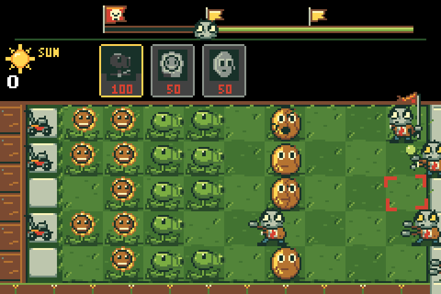
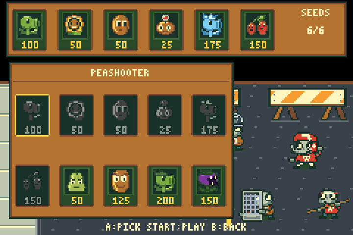
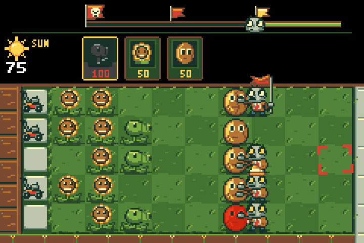
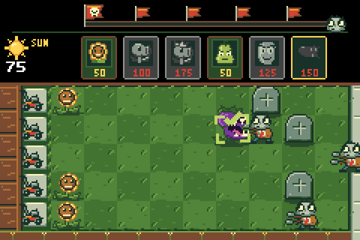
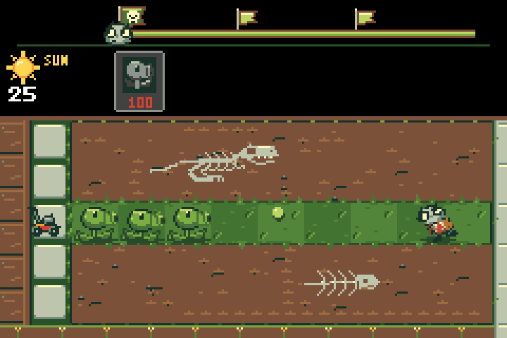
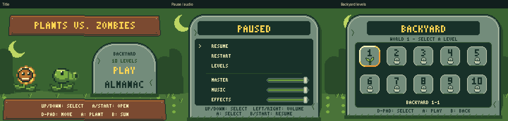

# Plants vs. Zombies for Game Boy Advance

A Plants vs. Zombies remake for the GBA, built with [Butano](https://github.com/GValiente/butano).
There are ten Backyard levels, ten plants, eight zombie types, and three save slots.

**[Download the ROM](plants_vs_zombies.gba)** and open it in a GBA emulator or load
it onto a flash cartridge. Choose **Play** to start or continue a save.

[Player guide and more screenshots](docs/player/README.md) · [Build instructions](docs/development/README.md)

## The campaign

Level one starts with a single lane and Peashooter. Level two opens three lanes
and teaches you to clear old plants with the shovel and grow Sunflowers. From
level three onward, you have all five lanes to defend.

Clearing a level unlocks the next one and usually earns a new plant. Replays keep
that level's original plant selection and skip any tutorial you've already done.
The current campaign ends at Backyard 1-10; Night and Pool aren't included.

Before each round, the camera pans over to the road to show the incoming zombies
and their counts. Early levels bring all their plants automatically. Later on,
you choose six seed packets to take with you.

## On the lawn

Collect sun with B and spend it on plants with A. Sunflowers produce more sun;
falling sun alone won't cover a full garden. Uncollected sun disappears after a
few seconds. Hold B to keep collecting while you move and plant.

L/R switches seed packets. A packet turns gray when you can't use it, then fills
with color as it recharges. Hold Select and press A to shovel a plant when you
need its cell. You don't get the sun back.

The wave bar at the top marks each incoming horde. Its Flag Zombie speeds up
nearby zombies while alive. Ordinary groups arrive between hordes, and the final
horde brings more zombies.

Later yards have tombstones that block planting and stop peas. Each standing
stone raises a zombie when a horde starts. You can shoot or blast the stones down;
they crack and crumble as they're destroyed.

Each lane gets one mower. It clears the lane when a zombie reaches the house end,
but it's gone for the rest of the round. Another breakthrough in that lane ends
the game.

## Plants

| Plant | Sun | Use |
| --- | ---: | --- |
| Peashooter | 100 | Shoots peas down its lane. |
| Sunflower | 50 | Produces sun for more planting. |
| Wall-nut | 50 | Holds up zombies while other plants attack. |
| Potato Mine | 25 | Takes time to arm, then explodes on contact. |
| Snow Pea | 175 | Slows movement and biting with frozen peas. |
| Cherry Bomb | 150 | Blasts nearby zombies across three lanes. |
| Squash | 50 | Jumps onto a nearby zombie and crushes through armor. |
| Tall-nut | 125 | A tougher barrier that also stops Pole Vaulters. |
| Repeater | 200 | Fires two peas per attack. |
| Chomper | 150 | Swallows one zombie through its armor, then needs time to chew. |

Chomper can reach a zombie eating the Wall-nut in front of it. While chewing,
it's vulnerable and can't eat again.

## Zombies

Normal zombies are joined by **Coneheads, Bucketheads, Newspaper Zombies, Screen
Doors, Flag Zombies, Football Zombies, and Pole Vaulters** as you progress.

Cones and buckets take extra hits. A Newspaper Zombie runs once its paper breaks.
A screen door blocks peas and freezing, but not explosions. Football Zombies
charge with heavy armor. Pole Vaulters jump the first ordinary plant they reach;
Tall-nut stops the jump.

Equipment and arms fall off as zombies take damage. Plants and zombies flash red
when hit, and defeated zombies fall onto the lawn. Flag carriers drop their flags
as they collapse.

[Damage and death animations for all eight zombies](docs/player/README.md#zombie-damage-and-death).

## Saves, rewards, and menus

Each save slot keeps its own level progress and zombie kill counts. Continue or
delete a slot from the save menu; deletion asks for confirmation. Keep your
emulator's save file when moving or updating the ROM.

New plants arrive as bouncing seed packets after a win. Replaying a cleared level,
or finishing one without a new plant, earns a trophy. After the reveal, any button
returns to level selection.

The **Almanac** is on the title screen. Browse animated plant and zombie entries,
read their descriptions, and check costs, recharge times, health, and saved kills.
L/R changes pages; Up/Down scrolls longer descriptions.

START pauses the game. You can resume, restart, return to levels, or adjust Master,
Music, and Effects volume separately. Audio settings last until you close the game.

## Controls

| Button | During a round |
| --- | --- |
| D-pad | Move the planting cursor; hold to repeat |
| A | Plant |
| L / R | Change seed packet; hold to cycle |
| B | Collect sun; hold to keep collecting |
| Hold SELECT + A | Shovel a plant |
| START | Pause |

Use the D-pad and A in menus. In seed selection, A adds or removes a packet and
START confirms all six. In the Almanac, L/R changes pages, A opens an entry, and B
goes back. After a defeat, A/START retries and B returns to levels.

The [player guide](docs/player/README.md) has the unlock order, plant timings, enemy
counters, and more screenshots. The [development guide](docs/development/README.md)
covers building the ROM, editing assets, and running tests.

This is an unofficial fan project. Plants vs. Zombies and the original defeat
scream belong to PopCap / EA. See the [audio credits](tools/audio_sources/credits.json).
