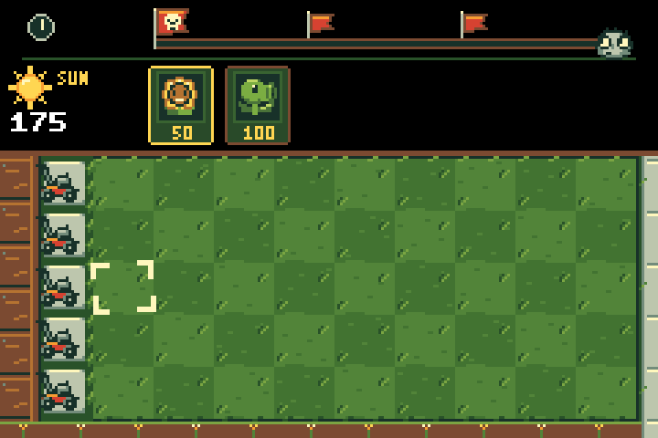
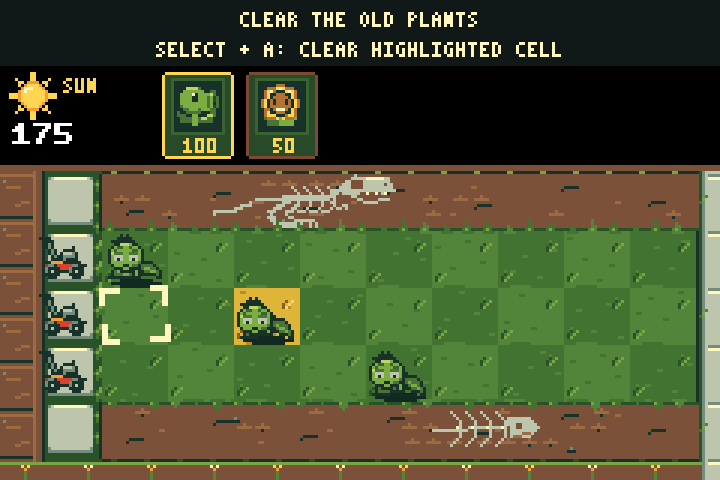
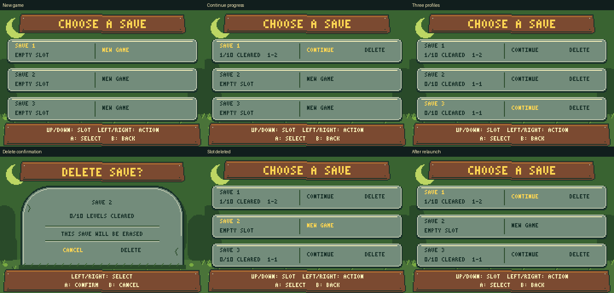

# Plants vs. Zombies for Game Boy Advance

A playable lawn defense game built with [Butano](https://github.com/GValiente/butano):
ten Backyard levels, ten plants, eight zombie types, persistent progress, an animated
Almanac, music, and separate audio controls.

Open [plants_vs_zombies.gba](plants_vs_zombies.gba) in mGBA or on a compatible GBA
flash cartridge. `plants_vs_zombies_debug.gba` unlocks all ten levels for testing;
early levels still keep their original plant selection. Debug progress is separate.



[Feature gallery](docs/README.md) · [Gameplay animation](docs/gameplay.gif) ·
[Development guide](docs/DEVELOPMENT.md)

## Playing

Choose **Play**, select an unlocked level, and scout the road. The camera pans
from the lawn to the planned enemies, showing the exact number of each road
zombie type. Tombstones can raise additional zombies during play. The preview
hides the HUD and puts the level name above “Incoming Zombies.” After the pan,
**A / START** begins directly when the level offers six plants or fewer. With a
larger roster it opens seed selection; **B** returns to level selection. The simulation
starts after the camera returns, so scouting does not use preparation time.

The lawn expands from one lane in 1-1 to three lanes in 1-2 and all five in 1-3.
Each lane has nine planting cells. Before each round, scout the road and choose up to six packets. Use the D-pad
to select a card, A to add/remove it, and START to confirm a full bank. Selected cards move into a six-slot tray at the top, over grey slot backgrounds. All ten choices remain in
a 5 × 2 grid below; A on a selected choice returns it from the tray. Unavailable plants leave empty cells,
and the chooser uses the tray and dimming instead of checkmarks or locks. The selection
overlays the road, with the incoming zombies animating beside it.
Levels with up to six available plants bring all of them automatically. On larger
rosters, START requires exactly six selections; an incomplete bank displays a red
“SELECT 6 SEEDS” error and keeps the picker open.

Every round starts with 175 sun and about
15 seconds to prepare. Each lane has one mower. A zombie reaching the house after
that defense is spent ends the round. Road zombies begin beyond the right edge
and walk into view.

| Button | During play |
| --- | --- |
| D-pad | Move the planting cursor; hold to repeat |
| A | Plant the selected seed |
| L / R | Previous / next seed; hold to cycle |
| B | Collect all available sun; hold to collect newly appearing sun |
| Hold SELECT + A | Shovel the selected plant, without a refund |
| START | Pause |

Seed packets contain an icon and price. Gray coloring and a vertical reveal show
affordability and recharge. A check marks a successful placement, a cross marks
an occupied cell, and a borderless hourglass marks a cooldown at the target cell.
A rejected purchase pulses the selected packet border. Collected sun credits
immediately and flies to the bank; it cannot credit twice.

## Backyard campaign

Levels unlock in order. Replaying a level uses that level’s original plant roster.
The first level offers only Peashooter and awards Sunflower. Its seven zombies
leave time for a planting and sun-collection tutorial. Level two starts with three
small wilted weeds scattered across the lawn: use Select + A to shovel them,
then plant a Sunflower and collect its sun. Each lesson requires the highlighted
action in order; zombies wait until it is finished. Sky sun starts with the first collection lesson; the second lesson
uses only Sunflower sun until it is finished. Completed-level replays skip the lessons. A shaded turf patch marks the required cell; a frame marks collectible sun on
the lawn. The Sunflower lesson plants at the back, beside the house. Dinosaur fossils, including a T. rex, decorate the early levels' unplanted dirt beds.




The next clear awards Wall-nut. Later clears award a counter before its matching zombie first appears.
Once more than six plants are available, choose which six to bring.

| Level | Lanes | Road zombies | New enemy | Plant earned on first clear |
| --- | ---: | ---: | --- | --- |
| Backyard 1-1 | 1 | 7 | Normal / Flag | Sunflower |
| Backyard 1-2 | 3 | 34 | — | Wall-nut |
| Backyard 1-3 | 5 | 38 | Conehead | Potato Mine |
| Backyard 1-4 | 5 | 41 | Buckethead | Snow Pea |
| Backyard 1-5 | 5 | 45 | Newspaper | Cherry Bomb |
| Backyard 1-6 | 5 | 77 | Screen Door | Squash |
| Backyard 1-7 | 5 | 82 | Football | Tall-nut |
| Backyard 1-8 | 5 | 88 | Pole Vaulter | Repeater |
| Backyard 1-9 | 5 | 88 | Shielded runners | Chomper |
| Backyard 1-10 | 5 | 93 | Final mixed hordes | — |

Later yards use distinct enemy mixes. 1-5 favors cones and newspapers; 1-6 brings
buckets and screen doors; 1-7 swaps those shields for football rushes; 1-8 pairs
buckets with vaulters; 1-9 mixes runners, doors, football players and vaulters.
Only the finale combines every type. Counts, spawn spacing and grave pressure
increase across the campaign, with lighter mixes between the tougher yards.

The first two rounds leave the unused lanes as bare soil. Planting, cursor movement,
sun drops, zombies, and mowers all stay within the active lanes. Replaying early
levels keeps their smaller lawn and original roster. Tombstones begin in 1-6.

The track advances toward each horde flag. Ordinary zombies arrive between flags;
each horde begins with a flag zombie, and its flag turns yellow when that leader
enters the screen. Groups overlap once half the current group has died. Remaining
queued spawns are retained. The final horde is larger, and there is no preparation
break between groups.

Standing tombstones block planting and absorb six peas, including frozen peas.
Cracks show damage, and destroyed stones crumble into rubble. They stop blocking
immediately while the crumble animation finishes. Shooters target stones before
zombies arrive; bombs and
mowers can also destroy them, while the shovel cannot. Each standing stone raises
one normal zombie when a flag zombie enters. Destroying it prevents future raises.
Already triggered raises wait for an enemy slot if needed. Zombies climb from
the dirt for 0.8 seconds before walking or biting and can be damaged during the climb.
Raised zombies must also be defeated to complete the level.

A new plant arrives as a bouncing seed packet. Replayed levels and clears without
a plant unlock award a bouncing trophy. Active explosions, moving mowers and zombie
death effects finish before the reward starts. The HUD stays visible, with the
reward above a wooden information sign. There is no floating reward heading or
button prompt. After the reveal, **any button** returns to level selection,
including after Backyard 1-10.

When the house is breached, music stops, a record scratch and the original defeat
scream play, and the loss animation runs before input is accepted. **A / START**
retries through scouting; **B** opens level selection.

## Plants and zombies

Times assume approximately 60 simulation updates per second. Natural sun falls
every ten seconds after the initial drop. Uncollected sun expires after six
seconds, before the same Sunflower produces again at its normal nine-second
interval. The tutorial brings forward its first sky/flower sun to about 1.5
seconds, then uses the normal production interval.

| Plant | Cost | Recharge | Role |
| --- | ---: | ---: | --- |
| Sunflower | 50 | 4 s | Produces 25 sun about every 9 seconds |
| Peashooter | 100 | 3 s | Shoots down its lane |
| Wall-nut | 50 | 10 s | Absorbs bites and shows two damage stages |
| Potato Mine | 25 | 15 s | Arms in 8 seconds, then detonates on contact in its lane |
| Snow Pea | 175 | 7.5 s | Freezes zombies, slowing walking and biting |
| Cherry Bomb | 150 | 20 s | Short fuse, then a blast across three nearby lanes |
| Squash | 50 | 30 s | Leaps onto nearby zombies in its lane, crushing through armor |
| Repeater | 200 | 3 s | Fires two peas eight updates apart, every 1.5 s |
| Tall-nut | 125 | 15 s | 90 health; blocks Pole Vaulters without letting them jump |
| Chomper | 150 | 7.5 s | Swallows one nearby grounded zombie through armor, then chews for 15 s; earned after 1-9 |

| Zombie | Total durability | Behavior |
| --- | ---: | --- |
| Normal | 6 | Standard walking zombie |
| Conehead | 12 | Cone adds protection; appears from 1-3 |
| Newspaper | 22 | Paper absorbs 16 hits before full body health; runs when it breaks; appears from 1-5 |
| Flag | 6 | Leads hordes and increases nearby zombies’ movement and bite speed while alive |
| Buckethead | 36 | Bucket absorbs 30 hits before body damage; appears from 1-4 |
| Screen Door | 24 | Door blocks peas and freezing; blasts bypass it; appears from 1-6 |
| Football | 50 | Fast charge with a raised fist, 40-point helmet and 10 body health; appears in late hordes from 1-7 |
| Pole Vaulter | 8 | Jumps the first ordinary plant and drops his pole, then walks more slowly; stopped by Tall-nut; appears from 1-8 |

Chomper can reach zombies biting a Wall-nut in the next cell. It waits with open
jaws, pulls its target into its mouth, then chews with a hand and boot hanging out. Swallowed zombies do not leave a falling corpse.

Plants and zombies flash red when hit, while their ground shadows retain their
color. A zombie loses an arm at half body health; the missing arm stays missing, with a small exposed bone tip at the sleeve. Detached arms are
small and drop directly beside the zombie. Cones, newspapers, buckets, football helmets and doors
tumble away when broken or when their wearer dies. Zombies collapse onto the
ground and fade after death. Flag zombies release their flag, stagger backward,
and fall onto their backs in a separate death animation. Kill
credit and wave progression happen immediately; the cosmetic effects do not keep
a dead zombie in combat. Explosions render above plants across lane boundaries.

## Menus, Almanac, and saves

| Screen | Controls |
| --- | --- |
| Title | Up / Down selects Play or Almanac; A / START opens it |
| Save slots | Up / Down chooses a slot; Left / Right chooses Continue or Delete; A confirms; B returns |
| Delete confirmation | Left / Right chooses Cancel or Delete; A confirms; B cancels |
| Level selection | D-pad selects; A / START opens scouting; B returns to title |
| Road scouting | A / START begins directly with up to six available plants, otherwise opens selection; B returns to levels |
| Seed selection | D-pad selects; A toggles a packet; START confirms a full bank; B returns to scouting |
| Almanac grid | L / R switches pages; D-pad selects within the current page; A opens details; B returns to title |
| Almanac details | Up / Down scrolls the description; B returns to the grid |
| Pause | Up / Down selects; A confirms; Left / Right adjusts audio; B / START resumes |
| Completed reward | Any button returns to levels after the reveal |
| Defeat prompt | A / START retries; B opens levels |

Repeater recoils for each pea in its pair, with a short recovery and a second
windup. A new plant does not play a shooting pose until it actually fires.

The incoming screen packs the present zombie types toward the yard and keeps those positions while the seed
menu is open. Football and Pole Vaulter jerseys share a skull emblem.

Title selection uses text color. Locked levels have gray locks and completed
levels have checks. Almanac entries animate at integer pixel scales and show
plain descriptions, sun cost, recharge, durability, and lifetime kills by zombie
type as applicable. Zombie durability combines body health and armor. The Almanac
wraps each description automatically; Up / Down scrolls longer entries with a visible scroll bar. Descriptions are original summaries of the adapted mechanics. The Almanac has two plant pages and two zombie pages; L / R cycles all four pages.

Pause actions are Resume, Restart, and Levels. Master, Music, and Effects sliders
adjust in 10% steps, default to 100%, and retain their settings through menu visits
and restarts. They reset on relaunch. Master scales both channels.

Three save slots independently store completed levels, unlocked levels, the last
started level, and lifetime zombie kills. Choose **Play**, select a slot, then
choose **New Game** or **Continue** to open its levels. **Delete** opens a
confirmation with **Cancel** selected by default. Deleting one slot leaves the
others untouched. Your existing current-format save appears in slot 1.

Each slot has two checksummed PVZ3 records. A confirmed deletion writes a newer
empty record so an older backup cannot revive deleted progress. Normal and debug
builds use separate save regions; every new debug slot starts with all ten levels
unlocked. Older save formats are unsupported. Keep your emulator's `.sav` file
beside the matching ROM.



The title shows the animated Sunflower and Peashooter. Title, save selection and
delete confirmation use larger wooden control panels with room for both lines.


The runtime separates simulation, input/view state, audio, world sprites, menus,
and asset routing into composed services. See the [development guide](docs/DEVELOPMENT.md)
for ownership, frame ordering and the controller test suite.

## Build

Install devkitPro’s GBA tools (`devkitARM`, `grit`, `mmutil`, `gbafix`), Python 3,
and Butano. Butano is external; the default location is `~/gba_development/butano`.

```sh
export DEVKITARM=/opt/devkitpro/devkitARM
export PATH="$DEVKITARM/bin:/opt/devkitpro/tools/bin:$PATH"
make -j8 BUTANO_ROOT=/absolute/path/to/butano
make -j8 DEBUG_SAVE=1 BUTANO_ROOT=/absolute/path/to/butano
```

Run normal and debug builds sequentially because audio conversion uses shared
temporary files. Object directories and startup/save settings are separate. The
old `TEST_LEVEL` shortcut is retired; use the debug ROM’s level selector.

Character graphics have one sheet per plant or zombie in `graphics/plants/` and
`graphics/zombies/`. Each plant’s bank and reward packets are paired in
`graphics/seeds/`; backgrounds, other UI and effects have separate folders. The
[Pole Vaulter pose study](docs/pole_vaulter_study.gif) shows the pole, biting and
wounded poses. Splitting sheets keeps the same per-frame VRAM and sprite cost.

Generated assets are included. To change artwork or audio, edit its source and
regenerate before building:

```sh
python3 -m pip install Pillow
python3 tools/generate_assets.py
make -j8
make -j8 DEBUG_SAVE=1
```

Music and most effects are synthesized. The defeat audio combines a CC0 record
scratch with the original Plants vs. Zombies scream. The scream is **not CC0**;
rights remain with PopCap / EA. See [audio credits](tools/audio_sources/credits.json).
The shared generated gain is 1.5×; mower and explosion effects receive a further
1.5× boost. The volume sliders attenuate these baselines.

## Verification and documentation

```sh
sh tools/test.sh
```

The C++17 host suite uses AddressSanitizer and UndefinedBehaviorSanitizer. It covers
all ten campaign clears, exact road rosters and conditional grave spawns, unlocks,
combat, shields, freezing, economy, save compatibility, rewards, death effects,
and mixer settings.

To rebuild, test, capture and publish the complete gallery in one command, install
Pillow and libmgba development headers/libraries, then run:

```sh
sh tools/refresh_docs.sh
```

The script runs both builds, the host suite, all four ROM smoke modes, and extra
button-driven gallery scenarios sequentially. It publishes fresh PNGs/GIFs,
records ROM hashes and capture sources, and removes retired gallery images only
after validating every input. Player `.sav` files are untouched.

For a custom installation:

```sh
BUTANO_ROOT=/absolute/path/to/butano \
MGBA_INCLUDE_DIR=/absolute/path/to/include \
MGBA_LIBRARY_DIR=/absolute/path/to/lib sh tools/refresh_docs.sh
```

`JOBS`, `CC`, and `CXX` may also be overridden. See the [gallery refresh guide](docs/README.md#refreshing)
for individual capture commands, and the [development guide](docs/DEVELOPMENT.md)
for runtime, asset and save-format details. Emulator checks do not establish
performance or perceived audio volume on physical GBA hardware.
