# Plants vs. Zombies for Game Boy Advance

Plant a garden, collect sun, and keep the zombies away from the house. This GBA
adaptation has a ten-level Backyard campaign, ten plants to unlock, eight kinds
of zombies, and three save slots.

You start with one lane and a Peashooter. By the last level, you're choosing six
seeds for a full lawn of armored zombies, flag-led hordes, and graves that won't
stay quiet.

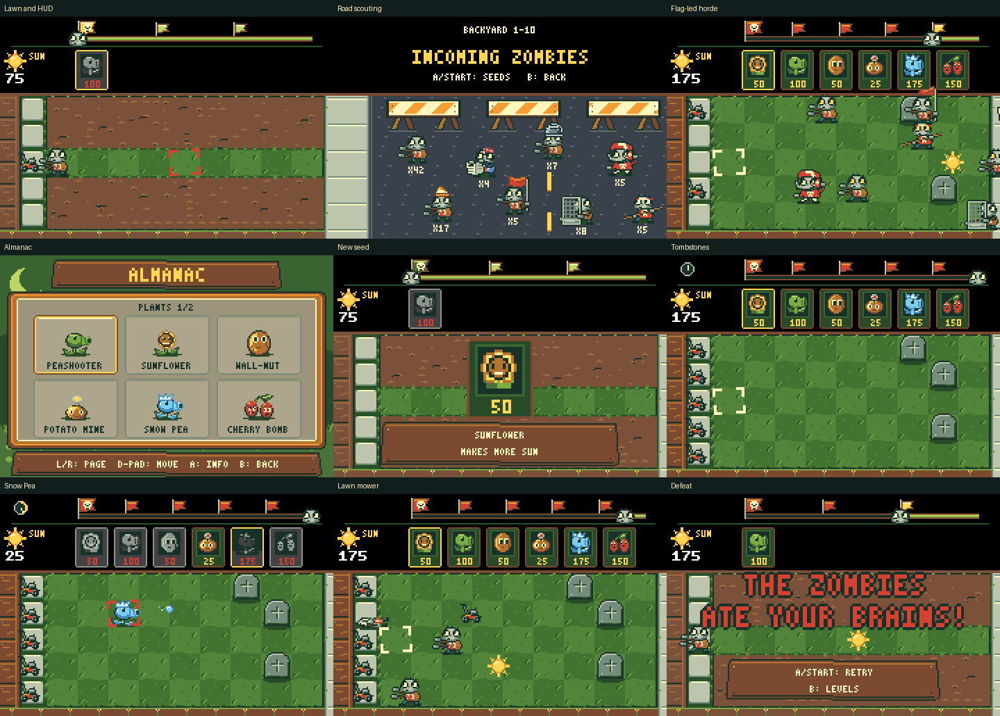

[Illustrated player guide](docs/README.md) · [Development guide](docs/DEVELOPMENT.md)

## Play

Open [plants_vs_zombies.gba](plants_vs_zombies.gba) in a GBA emulator such as mGBA,
or load it onto a GBA flash cartridge. Choose **Play**, pick one of the three save
slots, and start a new game. Choose **Continue** to return to that slot's levels.
Keep your emulator's save file when moving or updating the ROM.

The current campaign is **Backyard, levels 1–10**. Night and Pool worlds aren't
included yet.

## From one lane to a full backyard

The first level teaches planting and collecting sun on a single strip of grass.
Level two opens three lanes: clear the wilted plants with the shovel, then plant
a Sunflower near the house and collect what it produces. From level three onward,
you defend all five lanes.

The lessons wait for you to complete each action before the zombies start.
Replaying a completed level skips the tutorial.

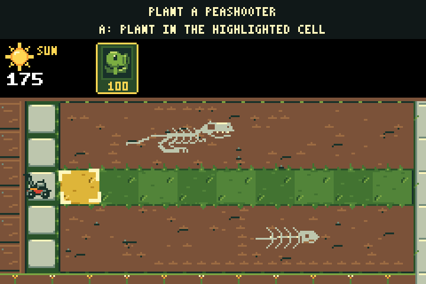

Clear a level to open the next one and earn a new plant. Each level keeps its own
plant roster when you replay it, so you won't bring a Chomper back into the first
Peashooter lesson. A gray lock marks a level you haven't reached; a check marks
one you've cleared.

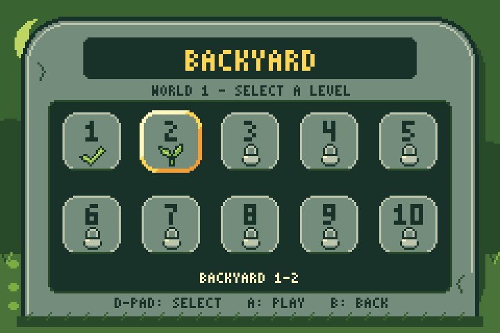

## Scout first, then choose your seeds

Before planting, the camera moves across the yard to the road. You'll see which
zombies are coming and a count for each type. Check for fast attackers, heavy
armor, and Pole Vaulters before deciding what to bring.

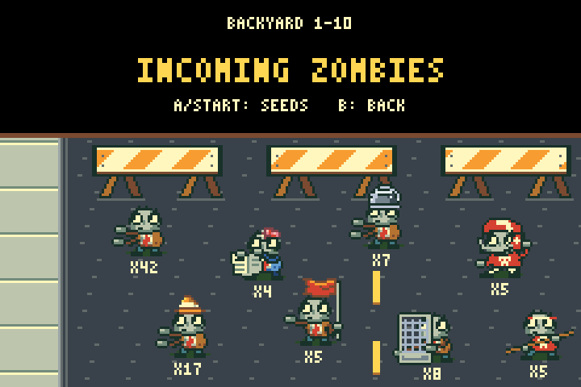

Early levels bring all their available plants automatically. Once there are more
than six choices, pick **exactly six** packets from the grid. Selected packets
slide into the tray above. Press A again to put one back, then START when your
bank is full. Scouting and seed selection don't use your preparation time.

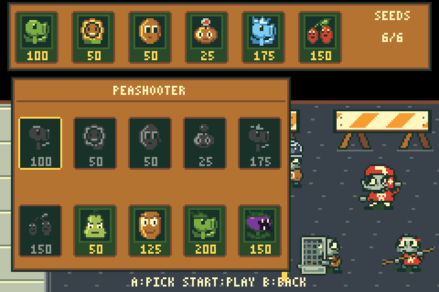

## Defend the lawn

Sun pays for plants. Collect falling sun and grow Sunflowers to keep planting;
sky drops alone won't support a busy lawn. Press B to collect the available sun,
or hold it to collect new drops as they appear. Collected suns fly to the counter.
Uncollected sun disappears, so don't leave it sitting around.

Every packet shows its price. Gray packets are unavailable, and color fills upward
as they recharge. Plant with A, switch packets with L/R, and use Select + A to dig
up a plant when you need the space. The shovel doesn't return its sun cost.

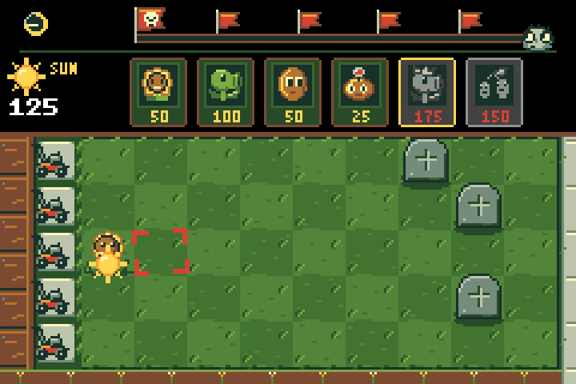

Peashooters handle a quiet lane. Wall-nuts buy time, Snow Peas slow a rush, and
Mines, Squash, and Cherry Bombs can save a lane that's getting away from you.
Repeater adds firepower; Chomper can swallow an armored zombie but needs time to
finish chewing.

The bar at the top tracks the round. Each flag marks a horde led by a Flag Zombie.
Flags turn yellow as their leaders enter the screen. A living flag carrier makes
nearby zombies move and bite faster, so taking it out helps the whole lawn.
Ordinary zombies arrive between hordes, and the last horde is the largest.

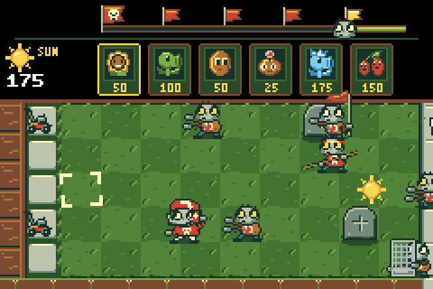

Later levels add tombstones. They occupy planting cells, stop peas, and raise
zombies whenever a horde leader arrives. Shoot them down or destroy them with a
blast before the next flag. Broken stones crumble; raised zombies crawl out of
the dirt before joining the fight.

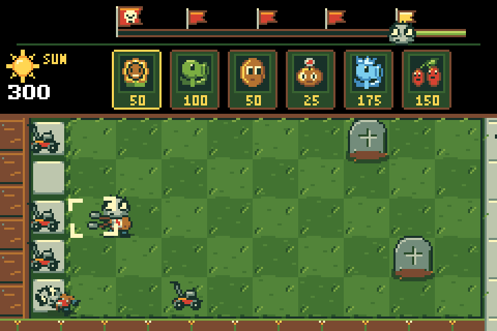

Each lane has one lawn mower as a last chance. A zombie that reaches it sends it
racing down the lane. Once it's gone, another breakthrough in that lane costs you
the round.

## Your plants

| Plant | Sun | What it does |
| --- | ---: | --- |
| Peashooter | 100 | Shoots peas down its lane. Your first defender. |
| Sunflower | 50 | Produces more sun so you can grow the garden. |
| Wall-nut | 50 | Holds zombies in place while your shooters work. |
| Potato Mine | 25 | Needs time to arm, then explodes when a zombie reaches it. |
| Snow Pea | 175 | Slows walking and biting with frozen peas. |
| Cherry Bomb | 150 | Explodes after a short fuse, hitting nearby zombies across three lanes. |
| Squash | 50 | Jumps onto a nearby zombie and crushes through armor. |
| Tall-nut | 125 | Takes more punishment and stops Pole Vaulters from jumping. |
| Repeater | 200 | Fires two peas in each burst. |
| Chomper | 150 | Swallows one nearby zombie through its armor, then spends time chewing. |

Chomper can reach over a Wall-nut to eat the zombie biting it. Tall-nut is your
answer to a Pole Vaulter, who can jump the first ordinary plant in his path.

## The zombies

There are eight types: **Normal, Conehead, Buckethead, Newspaper, Screen Door,
Flag, Football, and Pole Vaulter**.

Cones and buckets take extra hits. Newspapers shield their owners until they
break, at which point the zombie starts running. Screen doors stop peas and
freezing, but explosions get through. Football Zombies charge with heavy armor;
Pole Vaulters jump your first plant unless a Tall-nut stops them.

Damage shows on the zombies: equipment falls away, arms drop off, and defeated
zombies collapse on the lawn. Plants and zombies flash red when hit. Flag
carriers drop their flags as they fall.

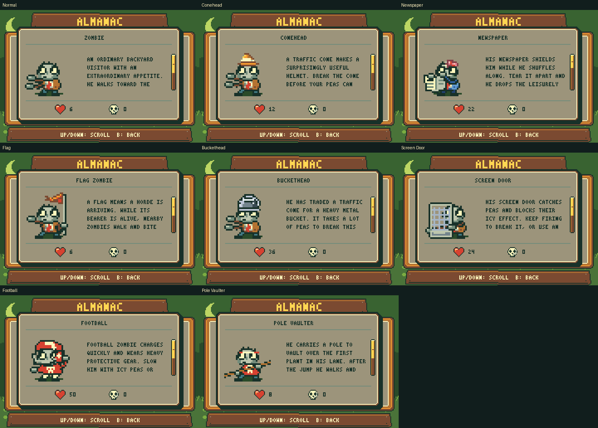

## Rewards, saves, and the Almanac

New plants arrive as bouncing seed packets above a wooden sign. Replay a cleared
level, or finish one without a new plant to earn, and you'll get a trophy instead.
After the reveal, press any button to return to the level screen.

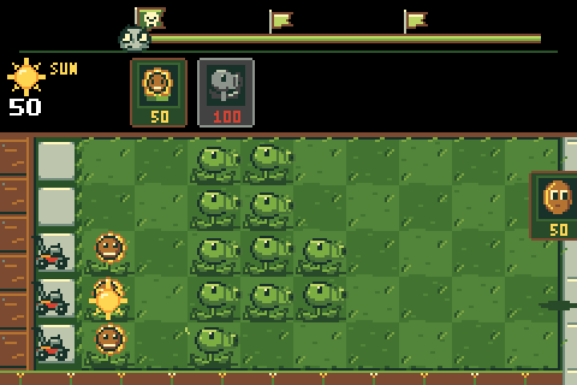

Each of the three save slots keeps its own level progress and zombie kill counts.
You can continue or delete a slot from the save menu; deletion asks you to confirm.

Open the **Almanac** from the title screen to browse animated plants and zombies.
Select an entry to see its description and stats. Plant entries show sun cost,
recharge, and health; zombie entries show durability and your saved kill count.
Use L/R to change pages and Up/Down to scroll a longer description.

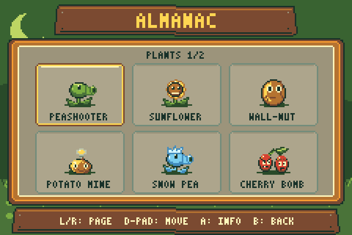

Press START during a round to pause. You can resume, restart the level, return to
level selection, or adjust Master, Music, and Effects volume separately. Volume
settings stay with you during the session and return to their defaults on relaunch.

## Controls

| Button | On the lawn |
| --- | --- |
| D-pad | Move the planting cursor; hold to keep moving |
| A | Plant the selected packet |
| L / R | Previous / next packet; hold to cycle |
| B | Collect sun; hold to keep collecting |
| Hold SELECT + A | Shovel the plant under the cursor |
| START | Pause |

In menus, use the D-pad to select and A to confirm. Scouting also accepts START
to continue. In seed selection, A adds or removes a packet and START confirms all
six. In the Almanac, L/R changes pages, A opens an entry, and B goes back.

If the zombies reach the house, the music stops and the defeat sequence plays.
Afterward, A/START retries the level through scouting and B returns to levels.

[See the full player guide and screenshot gallery](docs/README.md) for the unlock
order, plant timings, enemy counters, and more of the game in motion.

## About the project

Built in C++ with [Butano](https://github.com/GValiente/butano), with pixel art,
animated menus, music, and sound effects adapted to the handheld. This is an
unofficial fan project based on Plants vs. Zombies. The original game and defeat
scream belong to PopCap / EA; see the [audio credits](tools/audio_sources/credits.json).

For building the ROM, working on the artwork, or running tests, see the
[development guide](docs/DEVELOPMENT.md).
