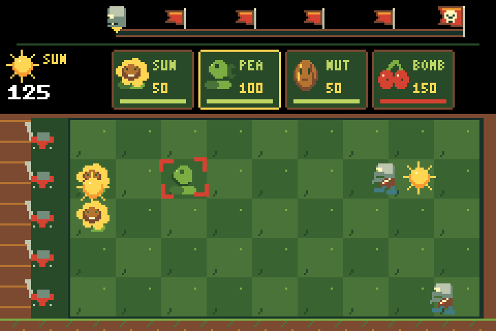
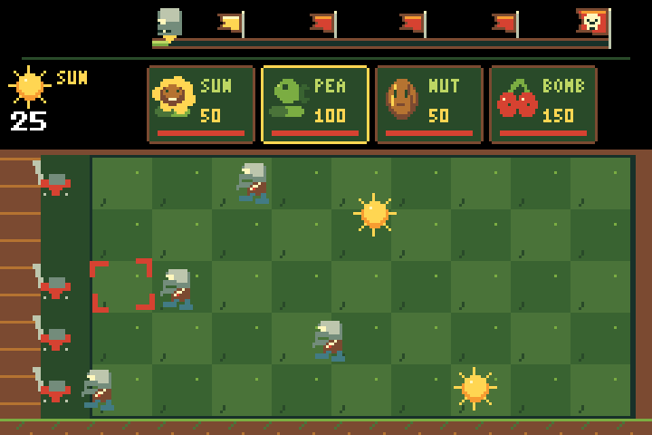
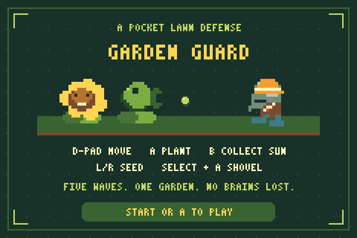
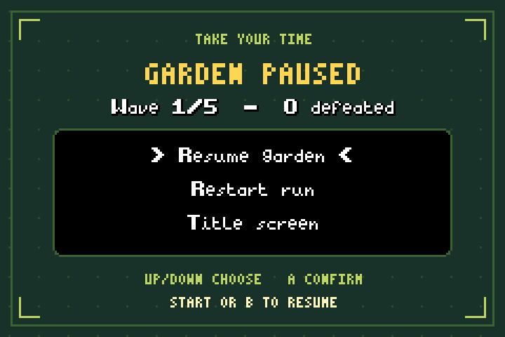

# Garden Guard — GBA MVP

A playable Plants vs. Zombies-inspired lawn defense game built in C++ with
[Butano](https://github.com/GValiente/butano). Uses original, generated pixel art
and synthesized sound effects. Open **garden_guard.gba** in mGBA or copy it to a
GBA-compatible flash cartridge.



## Play

| GBA button | Action |
| --- | --- |
| START | Begin, pause/resume, or restart after winning/losing |
| D-pad | Move the lawn cursor; hold to repeat |
| L / R | Cycle the four seed packets |
| A | Plant the selected seed at the cursor |
| B (tap or hold) | Collect all sun; hold to keep collecting new tokens |
| Hold SELECT + A | Remove the plant under the cursor; no refund |

On the title/results screens, A also starts a run. On results, B returns to
the title. Pause has a menu: Up/Down selects Resume, Restart, or Title, and A
confirms. START or B immediately resumes.

Survive five waves. A zombie reaching the house loses the game. Each lane has
one lawn mower that automatically activates as a last defense. The next wave
starts after the current wave is defeated and a short breather passes.

| Plant | Sun cost | Purpose |
| --- | --- | --- |
| Sunflower | 50 | Produces a collectible 25-sun token every eight seconds |
| Peashooter | 100 | Fires at zombies ahead in its lane |
| Wall-nut | 50 | Holds zombies in place while they chew |
| Cherry bomb | 150 | Explodes after a short fuse, hitting nearby zombies in three lanes |

You start with 175 sun and 15 seconds before the first zombie appears. Plant
sunflowers early, collect sun with B, and cover every lane with peashooters.
Each seed has a recharge bar: yellow fills while recharging, green means ready,
and red means you need more sun. The cursor is cream for a valid placement,
red when blocked, and gold while holding SELECT to shovel. The footer shows
an illustrated soil border; gameplay feedback uses icons and animation.
Cone zombies take twice as many hits as ordinary zombies.

The wave bar has a dedicated 24-pixel header with padding around the flags and
a gap above the seed packets. Its continuous track has five flag markers and a
moving zombie head. The track extends left to x=56 while keeping its right edge
at x=224. The generated `include/wave_track.h` shares exact integer boundaries
between the artwork and renderer. Unscaled segments, flag poles, fill frontier,
and the head's pointer meet at the same pixel at every wave checkpoint.
Red flags mark upcoming waves, gold marks progress through a wave,
and green marks a cleared wave. Compact pennants have shorter poles and clean
cloth shading. The slightly larger final pennant has a six-pixel skull with
a rounded cranium, recessed eye sockets, nose, and a narrower, toothed jaw.
Its 12-by-10-pixel cloth leaves a visible margin around the skull.
Its cloth stays red until cleared
to preserve contrast. Defeating zombies
advances the track; queued enemies still count toward each wave's total.
A circular clock shows preparation time, and a waving flag signals an incoming
wave. Wave changes also have sound cues.

Placement feedback stays at the action: a red cross and cursor shake for an
occupied tile, a green check for a successful plant, and an hourglass badge over
the recharging packet's illustration. Its larger glass bulbs, narrow waist,
brass caps, and subdued dark backing stay distinct from the plant art while
leaving the price readable. Three sand levels track recharge progress.
The selection outline follows the packet's rounded corners and exact bounds.
An unaffordable packet's border pulses red while the sun bank
stays still. Holding SELECT
shows a shovel at the cursor. Every collected sun flies from its own position
to the sun icon over 24 updates, easing into the bank. The counter updates
immediately and bounces. Flights pause with the game, survive token expiry,
and cannot be collected or credited twice. Holding B also collects new tokens
while earlier ones are still flying. There are no gameplay status messages or
text banners.

Peashooters recoil when firing. Hits, mowers, and chewing have distinct sounds.
Chewing triggers when a bite actually damages a plant and uses its own sound
cooldown, so shooting cannot suppress it. Sound playback is rate-limited during
busy waves.
The bite effect uses two short, quiet, rounded notes with smooth envelopes.
It plays at 72% volume; its waveform contains no noise crunch.



Title, pause, and result screens have dedicated artwork on a separate Butano
background layer. The lawn background is used only during play; menus contain
no copied seed bar or empty lawn. Results include your wave, defeats, and time.




## Build

Install devkitPro's GBA toolchain (devkitARM, grit, mmutil, gbafix), Python 3,
and clone Butano. The default looks for the existing local Butano checkout at
`~/gba_development/butano`. Override it for another installation:

```sh
export DEVKITARM=/opt/devkitpro/devkitARM
export PATH="$DEVKITARM/bin:/opt/devkitpro/tools/bin:$PATH"
make -j8 BUTANO_ROOT=/absolute/path/to/butano
mgba garden_guard.gba
```

The Butano checkout is an external build dependency; it is not vendored into
this project. Assets are already generated, so Pillow is not needed to build.
To regenerate the original art and sound after editing the generator:

```sh
python3 -m pip install Pillow
python3 tools/generate_assets.py
make -j8
```

## Verify

Run the portable simulation tests with a host C++17 compiler:

```sh
sh tools/test.sh
```

These run with AddressSanitizer and UndefinedBehaviorSanitizer. They cover
sun spending/production/collection, simultaneous collection flights and arrival,
single credit per token, flight pause/expiry/restart behavior, seed cooldowns, invalid placement,
pause, shoveling, restart, cherry bomb damage, zombie biting, wall blocking,
chewing event cadence, pause/target removal silencing new bite cues, one-use
mowers, losing without defenses, and a complete five-wave victory
using ordinary player actions.

An optional headless integration check uses libmgba to run the actual ROM,
send button presses, check pause/restart screen behavior, and capture title,
gameplay, pause, defeat, restart, shovel, and explosion screenshots. It checks
every pause action, title entry, pause stability, restart behavior, visible
wave-bar progress and head/flag alignment at a completed wave, sun collection
while holding B, a stationary sun bank after
an unaffordable placement, a cooldown badge on the packet with a clear lawn
cell, and a status-text-free bottom
border. It also captures audio from a chewing-only encounter and checks that
the ROM produces a non-silent sound signal.
With Homebrew mGBA installed:

```sh
cc -Wall -Wextra -Werror tools/rom_smoke.c \
  -I/usr/local/include -L/usr/local/lib -lmgba -o build/rom_smoke
build/rom_smoke
```

Adjust include/library paths for your installation. Screenshots are written
as PPM files inside `build/`.

## Code layout

- `include/game.h`, `src/game.cpp`: deterministic simulation, shared tuning
  data, bounded entity pools, collision, economy, and wave progression. No
  Butano dependency, heap allocation, or rendering logic.
- `src/main.cpp`: GBA button mapping, key repeat, UI feedback, event-based sound, and the
  application loop.
- `include/presentation.h`, `src/presentation.cpp`: Butano backgrounds,
  shared sprite atlas, small animation offsets, cursor, and cached HUD text.
- `tools/generate_assets.py`: reproducible original art and audio.
- `tests/game_test.cpp`: public-API simulation tests and an automated defense
  strategy that verifies the full game can be won.

The renderer uses fixed pools of 45 plants, 16 zombies, 18 peas, 10 suns, and
five mowers. With four seed bars, five wave segments, cursor sprites, three
visual indicator sprites, and at most 20 text sprites reserved for menus and
the sun counter, the maximum is 128 sprites. A compile-time check enforces the
GBA's sprite budget. Collection flights reuse the ten sun slots and sprites,
so simultaneous collection does not increase the sprite budget. Matching actors share atlas
tiles and a single sprite palette. Simulation positions use integer subpixels
and advance once per update, targeting the GBA's native refresh rate.

## MVP scope

One daytime lawn, four plants, two enemy types, five deterministic waves,
win/loss statistics, pause/restart/title navigation, damaged wall-nut artwork,
animated cherry-bomb blasts, a flag-based wave bar, visual feedback, and
combat sound effects. No
campaign map, save system, music, touch controls, or original PvZ assets.
Timing and balance are in `include/game.h` and `src/game.cpp`.

The build and headless mGBA checks were run locally; physical GBA hardware
has not been tested.
