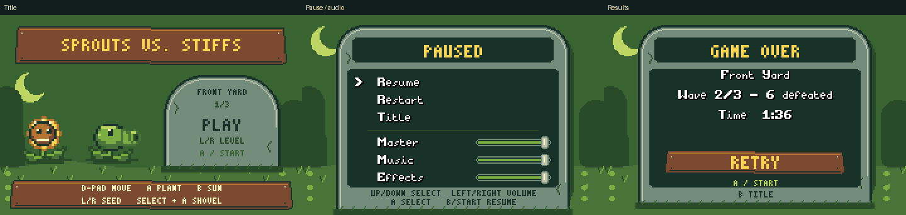

# Plants vs. Zombies for Game Boy Advance

A playable lawn defense game built with [Butano](https://github.com/GValiente/butano).
It has ten Backyard levels, six plants, six zombie types, persistent progress,
an animated Almanac, music, and adjustable audio.

Open [plants_vs_zombies.gba](plants_vs_zombies.gba) in mGBA or on a compatible GBA
flash cartridge. The debug ROM, `plants_vs_zombies_debug.gba`, starts with every
level unlocked and keeps its progress separate from the normal game.


## Playing

Choose **Play** on the title screen, then select an unlocked tombstone. Scouting
pans to the road and shows the exact number of each zombie type planned for that
level’s road spawns. Tombstones can raise additional zombies during the round.
The preview hides the gameplay HUD and displays the level name above
“Incoming Zombies.” Press **A / START** after the pan to return to the lawn.
Simulation starts after the camera returns; preview time does not use preparation time.

Defend the five-lane, nine-column lawn. Each level starts with 175 sun and about
15 seconds to prepare. Each lane has a single-use mower. A zombie reaching the
house after that defense is spent ends the round.

| Button | During play |
| --- | --- |
| D-pad | Move the planting cursor; hold to repeat |
| A | Plant the selected seed |
| L / R | Previous / next seed; hold to cycle |
| B | Collect all available sun; hold to collect newly appearing sun |
| Hold SELECT + A | Shovel the selected plant, without a refund |
| START | Pause |

The first level offers Sunflower and Peashooter. The next four levels introduce
Wall-nut, Potato Mine, Snow Pea, and Cherry Bomb, in that order. Replaying an early
level retains that level’s original plant selection. A first clear with a new
plant shows a bouncing seed packet; repeat clears and levels without a new plant
show a trophy. Any active explosions and moving mowers finish before the reward
bounce starts; combat and the economy stay stopped during that finish. The final
reveal leaves the HUD visible, with the seed above plant information on a wooden
sign, without a heading or button prompt. Once the reveal finishes, **any button**
returns to level selection, including after Backyard 1-10.

When the house is breached, music stops, a record scratch and scream play, and the
loss animation runs before input is accepted. **A / START** retries via scouting;
**B** opens level selection.

## Plants and zombies

Times assume approximately 60 simulation updates per second.

| Plant | Cost | Seed recharge | Role |
| --- | ---: | ---: | --- |
| Sunflower | 50 | 4 s | Produces 25 sun about every 9 seconds |
| Peashooter | 100 | 3 s | Shoots down its lane |
| Wall-nut | 50 | 10 s | Absorbs bites; appearance changes as health falls |
| Potato Mine | 25 | 15 s | Arms in 8 seconds, then detonates on contact in its lane |
| Snow Pea | 175 | 7.5 s | Slows movement and biting with freezing peas |
| Cherry Bomb | 150 | 20 s | Short fuse, then a blast across three nearby lanes |

Natural sun falls every ten seconds after the initial drop. Collected suns credit
immediately and fly to the bank; they cannot credit twice. Seed packets show an
icon and price, with a vertical recharge reveal and gray coloring when unavailable.
Placement feedback uses a check, cross, or borderless hourglass at the target cell.

| Zombie | Defense and behavior |
| --- | --- |
| Normal | Standard walking zombie |
| Conehead | Extra health from its cone |
| Newspaper | A durable newspaper shields full body health; runs when it breaks |
| Flag | Leads hordes and increases nearby zombies’ movement and bite speed while alive |
| Buckethead | Heavy bucket armor |
| Screen Door | Shield blocks peas and freezing; blasts bypass the door |

The wave track advances toward each horde flag. Between flags, ordinary zombies
arrive; crossing a flag starts a horde led by a flag zombie. Flags turn yellow
when that leader enters the screen. Groups overlap once half the current group
has died, so keeping one zombie alive cannot stall the level. Pending spawns are
retained, and the final horde is larger. There is no preparation break between groups.
Damage flashes plants and zombies red while their ground shadows retain their color.
Explosions render above plants across lane boundaries.

Backyard 1-5 and 1-6 have one tombstone, 1-7 and 1-8 have two, and 1-9 and 1-10
have three. Stones block planting and absorb six regular or frozen peas; cracks
show their damage. Shooters target them even before zombies arrive. Bombs and
mowers can also destroy them, but the shovel cannot. Every standing stone raises
one normal zombie when a flag zombie enters. Destroying it prevents future raises;
spawns already triggered wait for an enemy slot if necessary. Raised zombies climb
from the dirt for 0.8 seconds before walking or biting, and can be damaged during
the climb. Clear all raised
zombies as well as the road roster to finish the level.

## Menus, Almanac, and saves

Title options use font color to show selection. **Up / Down** selects Play or
Almanac; **A / START** opens it. In level selection, use the **D-pad** to move,
**A / START** to choose, and **B** to return. Locked levels show a gray lock;
completed levels show a check. Clearing a level unlocks the next.

The Almanac is available from the title. **L / R** switches plants and zombies,
the **D-pad** selects a cell, **A** opens details, and **B** closes details or
returns to the title. Entries animate at integer pixel scales. Details include
sun cost, recharge, health/armor, and lifetime kills by zombie type where applicable.

Pause offers Resume, Restart, Levels, Master, Music, and Effects. **Up / Down**
selects, **A** confirms an action, **Left / Right** adjusts a slider in 10% steps,
and **B / START** resumes. All sliders default to 100%. Audio settings survive
menu visits and restarts within the session, but are not saved across launches.

SRAM stores completed levels, unlocked levels, the last started level, and
lifetime kills by zombie type. Two checksummed records provide a backup. Legacy
saves migrate automatically. Normal and debug builds use separate save regions;
keep your emulator’s `.sav` file beside the corresponding ROM.



## Build

Install devkitPro’s GBA tools (`devkitARM`, `grit`, `mmutil`, `gbafix`), Python 3,
and Butano. Butano is external; the default path is `~/gba_development/butano`.

```sh
export DEVKITARM=/opt/devkitpro/devkitARM
export PATH="$DEVKITARM/bin:/opt/devkitpro/tools/bin:$PATH"
make -j8 BUTANO_ROOT=/absolute/path/to/butano
make -j8 DEBUG_SAVE=1 BUTANO_ROOT=/absolute/path/to/butano
```

Build normal and debug sequentially: their audio conversion uses shared temporary
files. Separate object directories keep their startup/save settings isolated.
The old `TEST_LEVEL` shortcut is retired; use the debug ROM’s level selector.

Generated BMP, WAV, MOD, and layout headers are included. To edit artwork or audio,
change its source and regenerate before building:

```sh
python3 -m pip install Pillow
python3 tools/generate_assets.py
make -j8
make -j8 DEBUG_SAVE=1
```

The original music and most effects are synthesized. Defeat audio uses a CC0
record scratch and the original Plants vs. Zombies scream. The scream is **not
CC0**; rights remain with PopCap / EA. See the source and processing information
in [audio credits](tools/audio_sources/credits.json). The shared generated output
gain is 1.5×; mower and explosion effects receive a further 1.5× boost. The mixer
sliders attenuate those baselines.

## Verification and development

```sh
sh tools/test.sh
```

The portable simulation suite uses C++17, AddressSanitizer, and
UndefinedBehaviorSanitizer. It covers all ten level clears, exact spawn rosters,
unlocks/replays, waves, combat, shields, freezing, sun collection, rewards, scouting,
progress serialization/migration, kill counters, and audio settings.

For actual ROM checks, install libmgba development headers and libraries:

```sh
cc -Wall -Wextra -Werror tools/rom_smoke.c \
  -I/usr/local/include -L/usr/local/lib -lmgba -o build/rom_smoke
build/rom_smoke plants_vs_zombies.gba
build/rom_smoke plants_vs_zombies_debug.gba debug
build/rom_smoke plants_vs_zombies.gba loss
build/rom_smoke plants_vs_zombies.gba legacy
python3 tools/generate_previews.py
```

Adjust include/library paths for your installation. Run checks sequentially because
they share capture filenames. The checks use fresh emulated SRAM and do not write
your `.sav` files. Screenshots must be newer than their ROM before publication.
These checks do not establish performance or perceived audio volume on physical hardware.

See the [current screenshot gallery](docs/README.md),
[development guide](docs/DEVELOPMENT.md), and [project notes](notes.txt).
