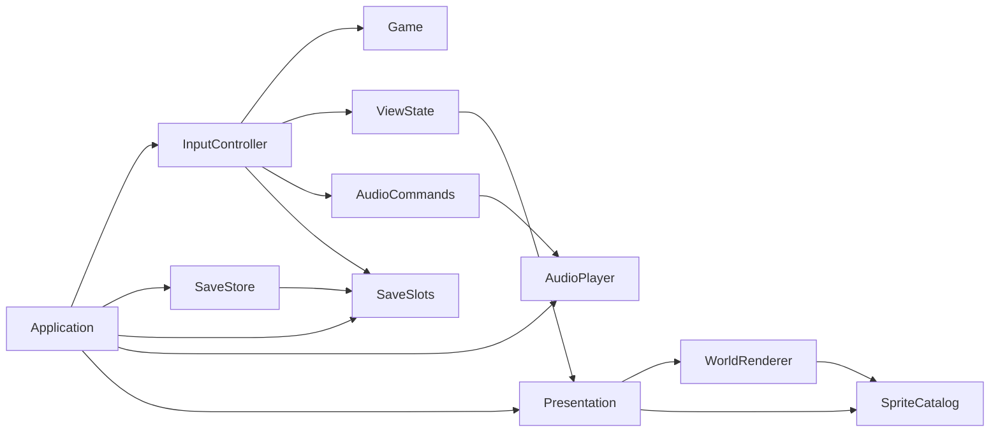

# Development guide

## Runtime boundaries

| Source | Responsibility |
| --- | --- |
| `include/game.h`, `src/game.cpp` | Deterministic simulation, levels, spawn rosters, combat and bounded entity/effect pools |
| `src/main.cpp`, `include/application.h`, `src/application.cpp` | Startup, keypad adapter, frame ordering and service composition |
| `include/input_frame.h`, `include/input_controller.h`, `src/input_controller.cpp` | Portable input snapshots, repeat timing, screen interaction and view-state updates |
| `include/view_state.h` | UI state shared by the controller and presentation, without Butano dependencies |
| `include/audio_commands.h`, `include/audio_player.h`, `src/audio_player.cpp` | Ordered UI cues, music/mixer changes, combat throttling and defeat/reward sounds |
| `include/presentation.h`, `src/presentation.cpp` | Screen transitions, backgrounds, menus, HUD and cached text |
| `include/world_renderer.h`, `src/world_renderer.cpp` | World actor/effect pools, preview actors, layering and hit/frost palettes |
| `include/sprite_catalog.h`, `src/sprite_catalog.cpp` | Central actor/packet/background routing and shared sprite placement |
| `include/menu_layout.h` | Shared navigation/rendering grid geometry |
| `include/almanac.h`, `include/text_wrap.h` | Catalogue copy, automatic wrapping and scroll bounds |
| `include/actor_animation.h` | Shared plant/zombie display poses |
| `include/tutorial.h` | First-play tutorial guidance |
| `include/progress.h`, `include/save_layout.h`, `include/save_slots.h`, `include/save_store.h` | Portable encoding, three-slot journals, active profile and SRAM I/O |
| `include/audio_settings.h` | Mixer limits and master/channel gains |
| `include/reward_animation.h` | Reward timing and integer bounce/zoom geometry |
| `include/defeat_audio.h` | Generated defeat timing shared by simulation, runtime and emulator checks |
| `include/seed_layout.h`, `include/wave_track.h` | Generated geometry shared by artwork and rendering |

`Application` composes concrete services. `InputController` owns `ViewState` and
repeat counters; it receives one `InputFrame` per frame and never reads hardware,
plays audio, or creates sprites. `AudioCommands` is a bounded eight-command queue
that preserves cue order, including mixer changes between sounds. `AudioPlayer`
consumes those commands and owns combat sound cooldowns. `Presentation` owns a
`WorldRenderer`; menus do not manipulate its individual actor pools. Actor-sheet
selection and placement are shared through `SpriteCatalog` and `draw_actor()`.
Resource owners cannot be copied. These boundaries introduce no virtual dispatch
or heap-backed entity containers.

The frame order is deliberate: snapshot keys and handle input, consume UI audio
commands and ensure music, tick the simulation, play simulation audio and save
progress, advance transient view timers, render, then call `bn::core::update()`.
Keeping that order preserves pause, feedback, defeat and reward timing. World
resources are released at the same screen transitions as before; splitting their
ownership keeps actor/effect capacities bounded. Save encoding remains explicit.

`Game` has no Butano dependency and uses no heap allocation. Positions use integer
subpixels (256 units per pixel). Pools hold 45 plants, 16 zombies, 18 projectiles,
10 suns, five mowers, three tombstones, and six cosmetic zombie effects.

`scheduled_zombie()` assigns a type to each planned road-spawn slot. The preview
roster and actual road spawning use the same schedule. Pending groups preserve
unspawned enemies when groups overlap or the live pool fills. Road actors start at x=256, fully beyond the 240-pixel
screen, and walk in normally. A flag announces its horde at its first visible
pixels (or if neutralized while entering), so wave flags do not change early.
Grave queues release on the next spawn update. Advances at the
half-defeated threshold do not discard those pending enemies.

Tombstone raises are conditional additions to that road roster. Each living stone
queues one normal zombie when a flag reaches the visible edge. Raises survive pool pressure
and count as pending enemies. They use group zero, so they do not alter the road
group’s half-defeated threshold. Destroying a stone prevents future triggers,
without canceling already triggered raises. A 48-frame emergence timer blocks
walking and biting while damage and status effects remain active.

The application handles input, ticks, consumes transient events, updates progress,
renders, and calls `bn::core::update()`, in that order. Preserve that order: input
can change phase before the tick, and combat events belong to the completed tick.
Screen-specific input methods retain each screen’s button priority. Shared level
selection transitions reset the view and navigation repeat state while retaining
session audio settings.

## Damage, death, and rendering

`Game::damage()` owns visual transitions as well as kill credit. Cone protection
ends at six health; the other shields have separate durability. Crossing half body
health drops an arm once and sets `arm_lost`. Wounded atlases retain the
missing arm in later walk, chew, and flag poses, with a two-pixel bone tip at
the remaining sleeve. Breaking equipment or killing a
wearer with intact equipment spawns the corresponding falling piece.

Deaths deactivate the combat entity and credit the original zombie type
immediately. A separate effect retains its position and corpse variant. Corpses
stagger, collapse onto the shared ground plane, then dither out over 48 updates.
Flag carriers have a separate 60-update backward fall and release a flag effect.
Equipment tumbles over 36 updates; small detached arms drop from the sleeve with
minimal horizontal movement and no upward throw. The six-slot cosmetic pool replaces the effect
nearest expiry when full; it never blocks spawning, changes health, or delays
group progression. Pause freezes effect timers. Effects can finish during defeat.

`SpriteCatalog::actor()` maps stable pose IDs into the relevant character atlas,
including wounded variants. `draw_zombie_effects()` uses separate corpse/debris
sprites, with shared palettes and lane depth. Falling equipment follows an integer
arc; source atlas rotation is baked with nearest-neighbor sampling. Arm reaches
are folded before corpse rotation so they cannot hold the head and torso above
the ground. Landing compresses the body vertically and spreads it slightly while
keeping its underside on the ground plane. The resting body touches a shallow
contact shadow. Detached arms face left like the original reaching arm, then
rotate hand-down and drift slightly forward as they fall. Newspaper
corpses and sleeves retain the newspaper zombie’s own palette. Corpse and debris
poses fit 32×32 sprites to keep OBJ tile use bounded during crowded fights.

Normal lane ordering keeps foreground lanes in front. Both Cherry Bomb and Potato
Mine explosions use a depth above every plant, so a blast cannot disappear behind
plants in another lane. The HUD remains on its own background priority.

The compile-time OAM budget includes cosmetic effects and remains below the GBA’s
128-sprite limit. The build raises Butano’s sort-layer limit to 64 for lane depth,
HUD and overlays. Host tests cannot detect tile/palette allocation failures; run
the ROM checks after changing atlases, effect capacity or resource ownership.

`Presentation::change_screen()` coordinates UI resource transitions and calls
`WorldRenderer::clear()` when the world should be released. Gameplay’s lawn is
separate from menu backgrounds. Pause clears entity sprites; reward and defeat
retain the lawn. Scouting uses a HUD-free panorama and independently scrolling
labels. Its returning ground pixels align with gameplay.

Victory enters the won phase immediately, then completes active explosions,
moving mowers and cosmetic zombie effects before advancing the reward clock.
`Plant::advance_explosion()` is shared between combat and victory. Live plant
timers, projectiles, sun production and input actions stay frozen during the
finish. The jingle follows the reward clock. Rewards share a raised seed/trophy
layout and wooden caption, with the HUD visible and no floating heading. After
the reveal, `bn::keypad::any_pressed()` returns to level selection.

Rendering caches should affect drawing cost only, never simulation timing.

In the Almanac grid, D-pad navigation wraps only among cells on its current page. Vertical
movement stays in the same column and ignores missing cells on partial pages.
Only L/R changes pages. `menu_layout::almanac_move()` shares those bounds with
host navigation tests; emulator checks cover both full and partial pages.

## Seed banks and new combat

`seed_order` is the unlock roster; it is distinct from the six-slot bank held by
`Game`. `unlocked_plants()` describes the level roster, `required_seeds()` caps it
at six, and `seed_at()` / `bank_slot()` route the chosen bank through input and HUD.
`plant_available()` checks actual bank membership. Rewards use the roster size,
so leaving a plant out cannot change the next unlock. `start()` defaults to the
first available packets for deterministic fixtures. The normal UI scouts first. If the level offers up to six plants, `choose_seeds()`
automatically confirms the complete bank and starts the return pan without showing
the picker. Larger rosters use `seed_select` and require six cards before returning. Selection
and scouting never advance sun, cooldowns, combat, or preparation time. The seed
panel is a transparent background over the shared road scene; it uses the same
road background with the scouting heading sprites released on entry. A shared staggered crowd layout serves both views, filled from the yard edge
for only the present types. Uneven horizontal and vertical gaps avoid perfect rows,
while depth sorting keeps nearer zombies in front; the pose clock carries across that transition
to avoid teleporting or resetting the displayed zombies.

The unlock roster begins with Peashooter and advances by one entry per clear:
Sunflower, Wall-nut, Potato Mine, Snow Pea, Cherry Bomb, Squash, Tall-nut, Repeater, Chomper.
Stable asset IDs stay independent of that order. Rewards now index all plant IDs,
including Sunflower, rather than assuming rewards begin at Wall-nut.

`LevelSpec::lanes` is 1, 3, then 5. `first_row()`, `last_row()`, and `row_active()`
are the shared simulation/controller bounds. Spawn row cycling uses a stride that
covers all active rows; natural sun targets the same range. Inactive mowers are
unavailable. Lawn and scouting variants use the same bare-soil mask so the return
pan lands on matching scenery. `draw_unplanted_soil()` draws continuous beds with
small clods, muted stones, broken furrows and uneven turf lips, without unused-row
seams. Both early lawn variants share this helper. All actor pools retain their five-row capacities.

The selector keeps a full five-column, two-row roster under a six-slot top tray. Per-type
packet sprites ease between their grid cell and the current bank slot on selection
and deselection. These sprites belong only to the menu and are released on exit.
Unavailable choices leave bare grey cells, with no icon, price, name or lock.
Selected cards are indicated by the top tray and dimmed grid artwork, without
checkmarks. An incomplete START shows red "SELECT 6 SEEDS" text for two seconds
and pulses the selection border; changing the bank clears the warning. The simulation
continues to stay frozen while the picker is open. Grey slot backgrounds stay visible while the colored packet moves. Returning
cards keep their grid copy dimmed until arrival, preventing a duplicate colored
card from appearing at the destination before the moving card gets there. Tray
slot bounds use `PACKET_WIDTH` / `PACKET_HEIGHT` directly, matching each packet’s
24 × 29 border rather than drawing a second larger outline.

Repeater shares the projectile pool and shooter cadence. Its extra shot is queued
eight updates after the first and retried if the pool is full. Each successful
shot starts six updates of recoil/recovery in `shot_frames`; animation is no longer
inferred from the reload timer, which also runs on initial placement. Squash locks a
nearby grounded target, crouches, leaps for 30 updates and crushes a small same-lane
area through armor. The flattened impact lasts 18 updates. Committed Squashes
finish their animation before rewards and cannot be eaten mid-leap.

Chomper is ready immediately on placement. It targets a grounded zombie within
39 pixels ahead (including a zombie biting the next-cell Wall-nut), animates for 36 updates, and strikes with 12 remaining. During
the preceding 12 updates, the target draws progressively smaller and closer to the
lunging jaw. A successful swallow bypasses armor, credits the kill, starts 900 updates of digestion and emits
a chomp cue. Swallow damage preserves normal kill/progression credit but suppresses
equipment drops and corpse effects. Chewing poses show dangling limbs; ready poses
keep the mouth open. Gameplay and Almanac share the four-beat idle pose routing.
The idle head, bending stem and leaves move independently of the ground shadow;
four chewing poses compress the jaw and tug the dangling limbs. A missed or removed target does not start digestion. Pending bites
finish before rewards; the long digestion timer does not delay the reward. All
chomp state freezes while paused, and emerging/vaulting enemies cannot be swallowed.

Later levels explicitly omit some previously introduced enemies through their
`LevelSpec` composition fields. 1-5 is a shorter newspaper yard, 1-6 uses stationary
shields, 1-7 uses newspapers/football, 1-8 uses buckets/vaulters, 1-9 uses mobile
shields/football/vaulters, and 1-10 combines all eight types. Exact preview counts
still come from the same schedule as actual spawning.

Pole Vaulters replace horde slot two from Backyard 1-8 (wave two), and wave one
from 1-9 onward. Tall-nut is already available from the clear of 1-7. A fresh pole vaults the first live grounded plant in 36 updates, except Tall-nut. During the vault
ordinary peas pass underneath; mines and Squash wait for grounded targets.
Four authored leg poses show push-off, tuck, extension and landing, retaining
the standing trouser color and black boots. The dropped pole uses the same shaft
and outline colors as the held pole. Frost doubles jump duration, and landing changes
speed from 52 to 28 subpixels/update. Tall-nuts are bitten without consuming or using the pole. Other plants are bitten normally. Jump state
uses the existing zombie slots; no extra live pool or OAM allocation is needed.

## Asset authoring

Edit the sources, then run `python3 tools/generate_assets.py`:

| Source | Output |
| --- | --- |
| `tools/pixel_art.py` | Plants, zombie poses, reusable cone/bucket details, icons and scenery helpers |
| `tools/zombie_effect_art.py` | Wounded atlases, corpse collapse/fade poses and detached equipment |
| `tools/menu_art.py` | Graveyard scenery, wooden signs and tombstones |
| `tools/asset_layout.py` | Shared graphics folder and asset path rules |
| `tools/generate_assets.py` | Indexed BMP/JSON assets, backgrounds, HUD, audio and generated headers |
| `tools/generate_music.py`, `tools/audio_config.py` | Original tracker music and shared output gain |
| `tools/audio_sources/` | Checked-in defeat recordings and per-source credits |

Generated graphics live in `graphics/plants/`, `graphics/zombies/`,
`graphics/effects/`, `graphics/seeds/`, `graphics/ui/` and `graphics/backgrounds/`.
`tools/asset_layout.py` is the shared path resolver for export and preview tools;
the Makefile includes these subfolders directly. Each plant and zombie has its own
sheet with poses stacked vertically. Most character frames are 32×32; screen-door
frames are padded to 64×32. The body stays centered while the upright door shifts
sideways and bobs slightly during bites. Four bite poses follow the actual bite
timer (rest, wind-up, bite and recovery), including frost and flag speed changes.
Each armor state has two walking frames followed by those four biting poses;
the second half repeats both armor states with the flag buff. The same unwarped
panel, mesh, kickplate and pale inner rail are used throughout.
Mesh uses its own blue-grey steel in slot 2
and the kickplate slot 4; skin stays in slots 12/13. The door shares Buckethead's
steel/clothing palette and frost variant, with no extra hardware palette slot.
A compact bent elbow keeps the near grip beside
the torso, while the far hand follows the panel. Each frame still uses one OAM entry; a door frame uses 1 KiB of sprite
tiles instead of 512 bytes. Basic zombies and Coneheads
have four normal poses (walk pair, bite pair), then the same four buffed poses;
matching wounded sheets use the identical order. Other character sheets keep their
existing pose order. Other UI sheets stay packed by function. `field_items` contains only
pea, sun and mower frames, with no duplicate character art.

Each plant also has a matching `<plant>_seed_packet` and `<plant>_reward_packet`
in `graphics/seeds/`. Every bank sheet is a single column of 60 native 32×32
frames: 30 affordable recharge states, then 30 unaffordable states. Each reward
sheet contains one 64×64 frame. Palette-specific plants follow the same layout;
there is no mixed packet sheet, plant offset arithmetic or duplicate reward art.
`seed_colors` applies the plant palette consistently to both exports, while the
renderer uses a single table in stable `PlantType` order.

Scouting and seed selection share `yard_road`, with `_1` and `_3` variants for
the early-level lane layouts. The scenery never includes text. `scouting_heading`
contains two 64×32 sprite halves that render “Incoming Zombies” above the road
only during scouting, following the same camera pan as the scene. These sprites
are released on screen changes, so seed selection has no heading behind its panel.

Butano references one selected frame when creating sprite tiles, rather than loading
an entire sheet into VRAM. Splitting the sheets therefore retains the existing
per-frame tile/OAM cost; identical palettes are still shared. Shadows remain packed
into their character frame, with a separate palette entry for independent coloring.
The Pole Vaulter's equipment is repainted after the wounded-body mask so a lost
arm cannot erase its pole or supporting grip. Biting keeps the feet planted and
animates the reaching hand and jaw.

Keep `PlantType` and `ZombieType` IDs stable: assets, save counters, catalogue
entries and pose routing depend on them. `seed_order` controls display/unlock order
separately from plant asset IDs. Edit generated layout headers through their
Python generator, rather than changing the headers alone.

Character authoring uses `SHADOW_PIXEL` for ground masks. Export packs the shadow
into palette index 15, keeping body colors in other slots. Hit and frost palettes
preserve shadow color. Chomper keeps the shared red price in palette slot 11;
its pink tongue uses slot 10 and mouth interior slot 14. Squash packets and rewards
keep stock color 2 from the standard card palette, independently of the actor’s
olive outline, so their backgrounds match the other packets. Wounded variants preserve the original atlas palette. Athlete sprites suppress
the ordinary jacket, shirt folds and reaching arms before drawing their own
jerseys and compact arm poses. Football trousers use the same off-white on both
legs, and biting freezes the feet and trousers while the jaw animates.
The newspaper sleeve outline stays steady during idle; the paper and grips bob
independently. Newspaper bites use a planted base pose and lower the paper
and both hands
together to expose the animated jaw; screen doors stay upright and shift aside
while the feet stay planted. Football and Pole Vaulter arm debris uses a red
jersey sleeve. Squash has a
dedicated pale yellow-green palette for its actor, bank packet, and reward.
Debris reserves unused slots for steel; paper sleeves use the paper palette.

Review native-size art and actual ROM rendering after palette/frame changes.
A correct BMP alone does not prove correct frame routing, layering or allocation.

Audio regeneration is offline. Preserve licensing in `credits.json`.
`defeat_audio.h` derives cue and input-unlock times from the actual recording
lengths. Shared output gain is 1.5×, with a further 1.5× for boom and mower sounds;
the resulting PCM stays within 16-bit range. Mixer sliders attenuate that output.

## Three-slot persistence

`save_format` in `progress.h` names the byte layout. Records are encoded explicitly
in little endian; they are not a dump of a C++ struct.

| Byte offset | Current 52-byte record |
| ---: | --- |
| 0 | `PVZ3` magic |
| 4 | Version 3 |
| 5 | Unlocked level count |
| 6 | Last started level index |
| 7 | Slot state: 0 occupied, 1 deleted |
| 8 | Completed-level mask, 32 bits |
| 12 | Sequence number, 32 bits |
| 16 | Football lifetime kills, using the previously reserved word |
| 20 | Original six 32-bit lifetime kill counters in stable zombie-type order |
| 44 | Pole Vaulter lifetime kills |
| 48 | Checksum over preceding bytes |

`SaveSlots` owns the portable state for three independent profiles. The controller
activates a slot before entering levels; `Application` syncs only that profile's
progress and `SaveStore` writes dirty journal entries. Empty slots stay empty at
boot. New debug slots use all-unlocked progression; normal slots start at 1-1.

`save_layout.h` shares addresses with the emulator harness. Slot pairs use a
4096-byte stride: normal bases are 768, 4864 and 8960; debug bases are 1024, 5120
and 9216. Each pair occupies 104 bytes. Slot one's existing addresses and occupied
record encoding remain unchanged, so current progress is available there without
a migration path. The regions fit within 32 KiB SRAM and are checked at compile time.

Loading validates both records and selects the newest sequence, including wrap.
Creation, changed progress and deletion mark only that profile dirty. Deletion
writes a checksummed empty record with a newer sequence instead of clearing one
copy and accidentally reviving its backup. Recreating a deleted slot continues its
journal sequence with fresh progress. Unsupported versions and invalid checksums
are rejected; a pair with no valid record is an empty slot. Counters saturate at
`UINT32_MAX`.

The profile screen offers New Game on empty slots and Continue/Delete on occupied
slots. Confirmation starts on Cancel. Returning to title preserves the active
profile for the Almanac; choosing another profile loads its own kill counts.

The title uses its animated Sunflower/Peashooter sheet again. Title and save
selection have taller wooden control panels. Save rows start two pixels higher;
the 28-pixel footer centers both control lines. Slot text uses dark stone-menu
ink with gold selections. The delete screen shows the selected
save and its cleared-level count, with distinct warning/action rows and the warning centered between its dividers. Its two
control lines are centered in a separate, taller wooden footer. Cancel remains
the default selection.

## Verification and publishing

The [root README](../README.md#verification-and-documentation) covers dependencies
and the complete `sh tools/refresh_docs.sh` workflow. Builds and capture runs must
be sequential because they share temporary/output files.

| Check | Coverage |
| --- | --- |
| `sh tools/test.sh` | Sanitized controller tests (repeat/input, navigation, cue order, mixer, seed selection, feedback and pause) plus three-profile journal/delete/reload tests, simulation, all ten campaign clears, rosters, economy, combat, shields, freezing, tombstones, emergence, arms/equipment/corpses, rewards and save encoding |
| Normal ROM smoke | Title/Almanac, locked levels, actual first-level clear and replay, reward dismissal, progress/reload, corrupt-backup recovery, lifetime kills, all three profiles and deletion/recreation |
| Debug ROM smoke | Unlocked selection/save isolation, late scouting, tombstones, emergence, blast ordering, hit colors, held seed cycling, freezing and hordes |
| Loss smoke | Record scratch/scream sequencing, input guard, music silence, retry and return to levels |
| Gallery mode | Additional button-driven placement, sun, shovel, mixer, mine, Wall-nut, mower and zombie-combat scenes |

The tests use fresh emulator SRAM and do not touch player `.sav` files. Gallery
mode includes the debug smoke sequence, then its additional scenes. No gallery
scenario patches game code, entity state or save memory.

Host campaign checks try deterministic legal planting strategies from the same
level-start fixture; a winning run must still clear every scheduled/raised enemy
and match all saved kill counts. This avoids treating one rigid bot as the game’s
only valid strategy.

`tools/rom_smoke.c` owns integration checks; `tools/rom_gallery.h` holds the extra
capture scenarios. `tools/generate_previews.py` validates source timestamps,
scales PNGs, assembles GIFs/contact sheets, and publishes the documented asset set.
It loads all captures and animation-study atlases before replacing images or
removing obsolete PNG/GIF files. `docs/captures.json` records ROM hashes, source
captures, timing and published filenames. Update that script and the gallery
links together when adding a scene.

ROM captures and generated sprite studies are labeled separately in the gallery.
Do not present a sprite composite as an emulator screenshot. Physical hardware
performance and perceived loudness remain hardware checks.

## Tutorial and text layout

`TutorialGuide` observes planting, shoveling and collection during the first two
unfinished levels. `InputController` owns it and publishes a `TutorialPrompt`;
`Presentation` draws a two-line header and a gold tint covering the full 22×19 cell. The controller
accepts only the required planting, shoveling or collecting action during each
step. Navigation and pause remain available. `Game::tick(hold_waves, hold_sky_sun)`
keeps the preparation/wave clock still while plant, existing sun and cooldown
timers run normally. Sky sun is held until the first collection lesson; level
two holds it through the full lesson so the first collected sun comes from the
Sunflower. The sky timer resumes without accumulating missed drops. Entering either
collection lesson hastens its first sun to 90 frames (1.5 seconds), without
changing later production. `sun_lifetime` is 360 frames (6 seconds), shorter
than the 540-frame Sunflower interval; collected suns still finish their flight
even if they were picked up just before expiry.
The cell highlight preserves the exact native grass pattern and draws behind
plants and the normal cursor. Each cell has a row-major sprite frame; only its
palette changes to gold. The gold overlay flashes on for 40 frames and off for
20, leaving the normal player cursor visible throughout. It does not use
another cursor outline. Collection lessons frame collectible sun on the lawn,
never the HUD counter. Sun
remembers whether it came from a plant; the Sunflower collection lesson marks
and collects only that sun. Level two seeds three inert, compact wilted weeds at scattered cells listed in
`tutorial_weeds`. Setup and the ordered shovel targets share this definition.
The Sunflower lesson requires the house-side column (row 2, column 0). Artwork uses the regular plant
greens and one-pixel contours. Four wilted poses cycle through a slow sag,
recovery and blink with staggered timing; roots and shadows stay fixed. Scouting
uses the initial pose so the lawn transition remains aligned. Shoveling frees their cells; replacement plants are ordinary actors.
Level one uses zero horde growth (seven enemies total); other levels keep their
existing growth and final-wave multiplier.

Almanac entries store one paragraph. `WrappedText<24, 32>` wraps at word boundaries
without allocation, splits oversized tokens, and explicitly marks capacity overflow.
The details view shows four left-aligned lines with a framed scroll track and a
shaded thumb whose size reflects the visible fraction of the description. The
44-pixel track has no arrow caps and sits on the right; detail content shares a
six-pixel left offset to reserve space for it. Only the Screen Door portrait and
grid preview compensate for their asymmetric transparent padding (4 native
pixels, doubled for the portrait); other character positions stay unchanged;
Up/Down scrolls with key repeat and clamps at either end. Pages change only from
the grid using L/R. Descriptions are original summaries, not copied game text.
Animation lookup helpers live in `actor_animation.h`, separate from Almanac copy.

All reward variants share `reward_panel`; trophies sit eight pixels higher than
seed rewards. The unused wave-clear audio and duplicate reward backgrounds have
been removed. Source generation remains in `tools/generate_assets.py`.
