# Player guide and screenshots

[Play and project overview](../README.md) · [Development guide](DEVELOPMENT.md)

A closer look at the Backyard campaign, what to bring into a level, and how the
plants and zombies work. The screenshots and gameplay GIFs below come from the
current ROM running in mGBA. Late-game captures use the debug ROM to open those
levels. Images are enlarged without smoothing the pixels.

## Starting a game

Choose **Play** on the title screen, then pick a save slot. Empty slots offer
**New Game**; existing slots offer **Continue** and **Delete**. Each slot has its
own campaign progress and zombie kill counts. Deleting a slot opens a confirmation
screen with Cancel selected.

Continue opens the level screen. Clear a level to unlock the next one. You can
revisit any cleared level, but its lawn size and available plants stay the same
as on your first visit.

## Learning the lawn

**Backyard 1-1** gives you one lane and Peashooter. Follow the flashing gold cell
to plant, then collect falling sun with B. The zombies wait until you've finished
the lesson.

**Backyard 1-2** opens three lanes and adds Sunflower. First, remove the three
wilted plants with Select + A. Then plant a Sunflower in the marked cell beside
the house and collect the sun it makes. The first lesson sun arrives quickly;
normal production follows afterward.

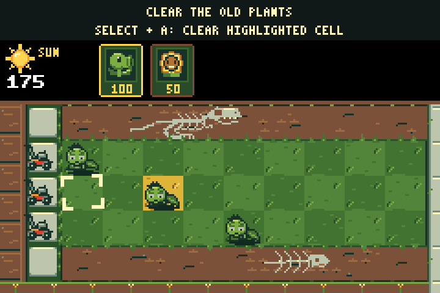

**Backyard 1-3 onward** uses all five lanes. You can plant in nine cells along each
lane. Fossils decorate the bare dirt around the smaller lawns, including a T. rex.

| First level: one lane | Second level: three lanes |
| --- | --- |
| 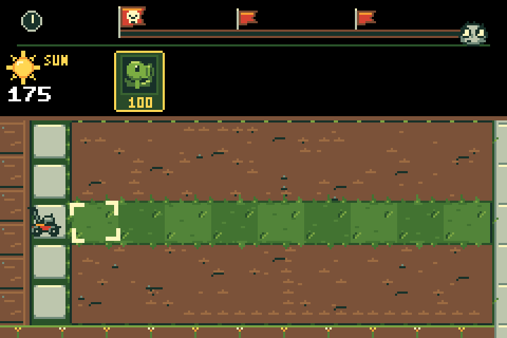 |  |

## What each clear unlocks

| Level | Lawn | What's new | Plant earned |
| --- | --- | --- | --- |
| 1-1 | One lane | Planting, sun collection, and your first hordes | Sunflower |
| 1-2 | Three lanes | Shoveling and growing your own sun | Wall-nut |
| 1-3 | Five lanes | Coneheads | Potato Mine |
| 1-4 | Five lanes | Bucketheads | Snow Pea |
| 1-5 | Five lanes | Newspaper Zombies | Cherry Bomb |
| 1-6 | Five lanes | Screen Doors and tombstones | Squash |
| 1-7 | Five lanes | Football Zombies | Tall-nut |
| 1-8 | Five lanes | Pole Vaulters | Repeater |
| 1-9 | Five lanes | A mix of fast attackers and shields | Chomper |
| 1-10 | Five lanes | Every zombie type in the final yard | Trophy |

The enemy mix changes between levels. A tougher zombie appearing doesn't mean
it will be in every later yard. The new plant is awarded before the level where
its matching enemy first appears: for example, you earn Tall-nut before meeting
Pole Vaulters.

The current game ends at Backyard 1-10. Night and Pool aren't playable worlds yet.

## Scouting and seed selection

The camera travels from the lawn to the road before each round. The road shows
the zombie types scheduled for that level, with a number beside each type. Those
counts cover the incoming road zombies; living tombstones can raise more during
play.

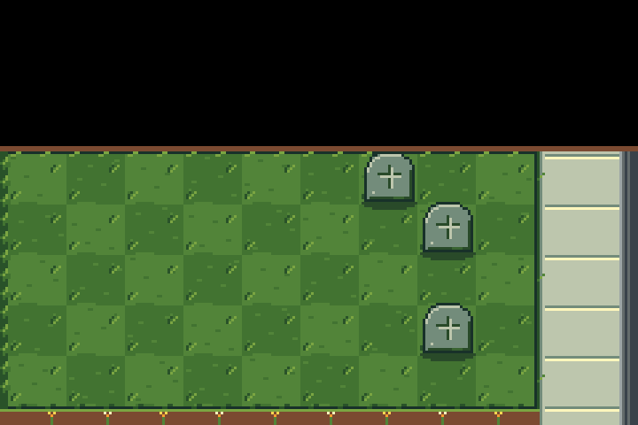

Press A/START to continue. If the level offers six plants or fewer, you take all
of them. With a larger roster, a seed grid opens over the road. Choose exactly
six packets: A adds or removes a plant, and START confirms your bank. The packets
move between their cells and the tray at the top. You can still see the incoming
zombies beside the selection panel.

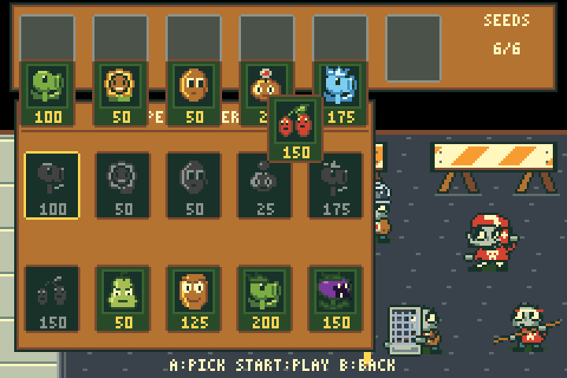

An incomplete bank stays on the selection screen and shows **SELECT 6 SEEDS**.
Press B to go back to scouting. You can take your time here; the level hasn't
started yet.

[See a custom bank](seed_selection_custom.png) · [See the incomplete-bank message](seed_selection_error.png)

## Sun, packets, and placement

You begin a round with **175 sun** and about **15 seconds** before the first
zombies, after any unfinished tutorial. Falling sun and Sunflowers each provide
25 sun per pickup. Sky sun arrives about every ten seconds; a Sunflower normally
produces about every nine seconds. Sun disappears after six seconds if you leave
it on the lawn.

B collects available sun across the lawn. Holding B keeps collecting new drops.
The sun flies to the counter as you collect it, so you can keep moving the cursor
and planting.

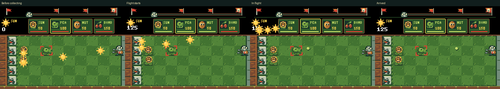

Each seed packet shows an icon and its sun price. Gray means you can't plant it
yet; color fills upward as it recharges. L/R cycles through the bank, and holding
either button keeps cycling.

A successful planting shows a check. An occupied cell shows a cross. If the
packet is still recharging, an hourglass appears at the planting cell. A rejected
purchase also pulses the packet's border.

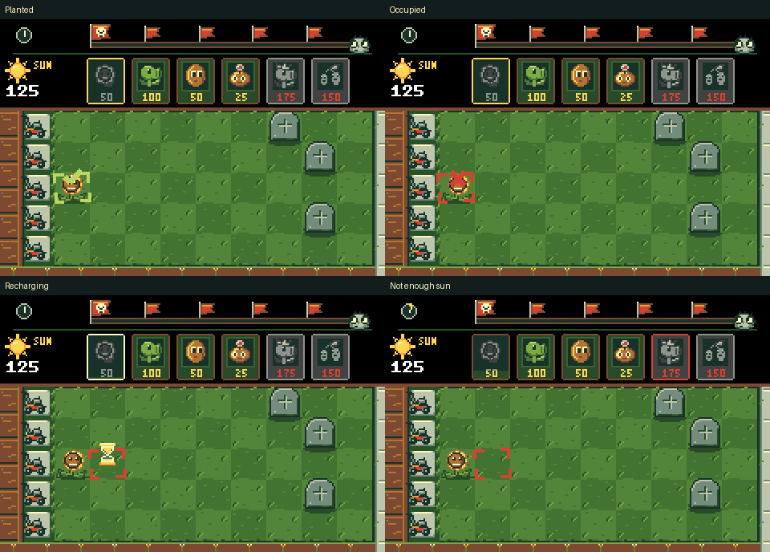

Hold Select and press A to remove a plant. There is no sun refund. The shovel
can't remove tombstones.

## Picking plants for the job

Recharge is the wait before you can place another of the same plant. It is
separate from a plant's own attack, arming, or chewing time.

| Plant | Sun | Recharge | How to use it |
| --- | ---: | ---: | --- |
| Peashooter | 100 | 3 s | Put steady fire behind your defenses. It can shoot tombstones before enemies arrive. |
| Sunflower | 50 | 4 s | Plant near the house to build your sun supply. Produces 25 sun roughly every 9 seconds. |
| Wall-nut | 50 | 10 s | Stall a lane while shooters work. Its face and shell show how much punishment it's taken. |
| Potato Mine | 25 | 15 s | Plant ahead of an approaching zombie. It takes 8 seconds to arm. |
| Snow Pea | 175 | 7.5 s | Slow walking and biting so the rest of the lane has more time to attack. |
| Cherry Bomb | 150 | 20 s | Use its short-fuse blast against a cluster in up to three neighboring lanes. |
| Squash | 50 | 30 s | Place near trouble. It leaps onto a nearby target and crushes through armor. |
| Tall-nut | 125 | 15 s | Has twice Wall-nut's health and prevents a Pole Vaulter's jump. |
| Repeater | 200 | 3 s | Fires two peas in quick succession. Useful where a single Peashooter can't keep up. |
| Chomper | 150 | 7.5 s | Swallows a nearby grounded zombie through armor, then chews for 15 seconds. Protect it while it eats. |

### Mines, bursts, and bites

A Potato Mine's light tells you when it's ready. An unarmed mine can be eaten,
so give it space to finish arming. Once triggered, it explodes in its own lane.

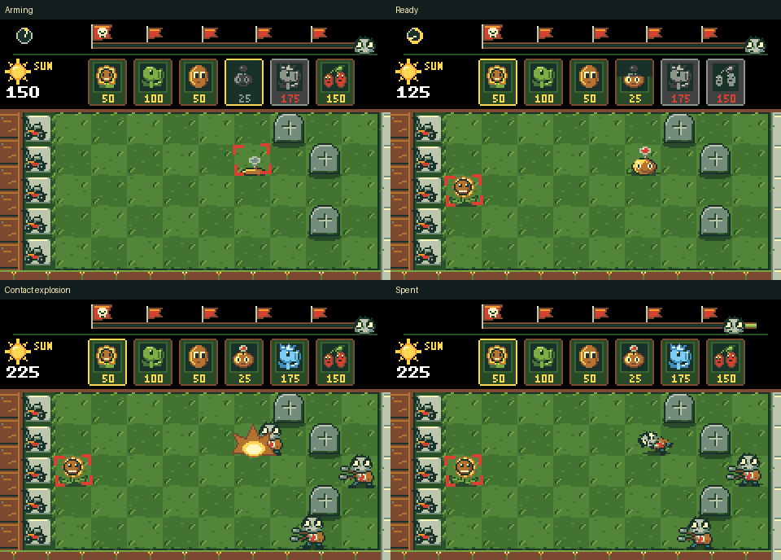

Repeater fires twice per attack, with a separate recoil for each pea. Squash
waits for something close enough, then leaps and lands on it.

| Repeater | Squash |
| --- | --- |
| 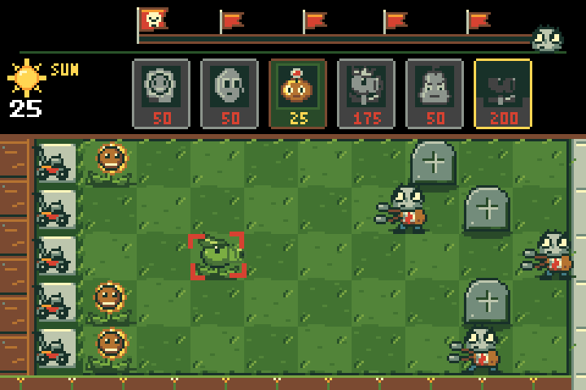 | 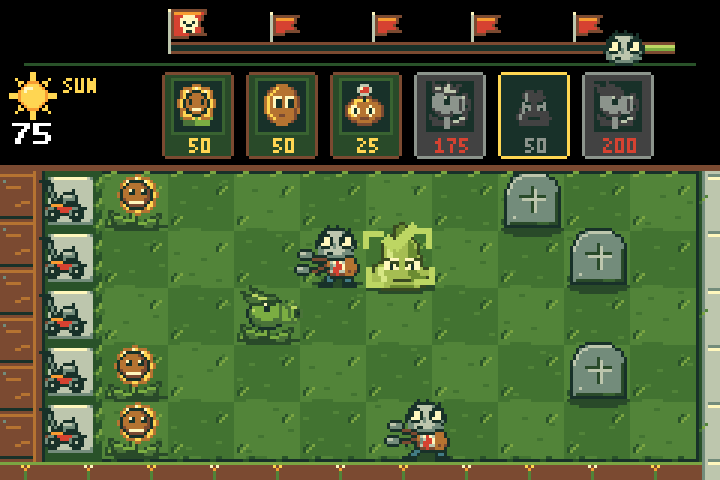 |

Chomper waits with its jaws open, pulls a zombie into its mouth, and chews with
bits of its meal sticking out. It can eat a zombie that's biting a Wall-nut in the
next cell, so a nut in front doesn't put that target out of reach.

[Browse every plant's Almanac entry](almanac_plant_entries.png)

## Know the zombies

| Zombie | What to watch for | What helps |
| --- | --- | --- |
| Normal | A steady walker that will eat through an unguarded lane. | Peashooters and a little preparation. |
| Conehead | Extra protection before you're down to the ordinary zombie. | More shooting time, a nut, or an armed Mine. |
| Buckethead | A bucket that takes far more peas to break. | Concentrated fire, slowing, or a plant that bypasses armor. |
| Newspaper | The paper absorbs damage. Once it breaks, the zombie runs. | Snow Pea to slow the rush, or a blast before it reaches you. |
| Screen Door | The door blocks peas and their freezing effect while intact. | Cherry Bomb, Squash, or Chomper. |
| Flag | Leads a horde and speeds up nearby zombies' walking and biting. | Taking down the carrier makes its neighbors easier to handle. |
| Football | A fast charge and a very tough helmet. | Have a Mine ready, slow it down, or use Squash or Chomper. |
| Pole Vaulter | Jumps the first ordinary plant it reaches, then slows down. | Tall-nut stops the jump; otherwise keep another defense behind the first. |

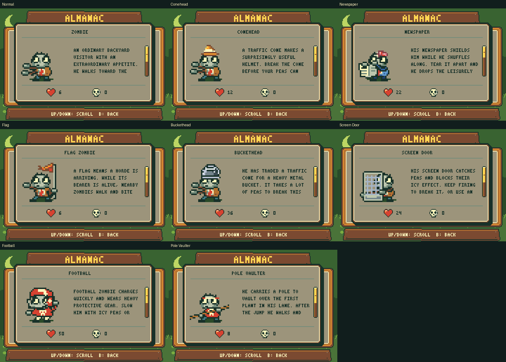

Snow Pea slows both movement and biting. A frosted zombie has a blue tint; a hit
flashes red. Plants also flash red when damaged.

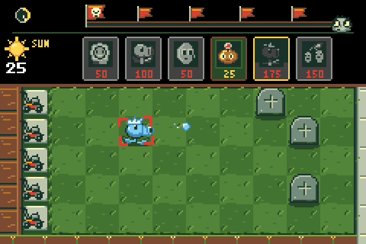

As zombies take damage, arms fall off and equipment breaks away. Football and
Pole Vaulter arms keep their jersey colors. The surviving zombie keeps its missing
arm, with a little bone showing at the sleeve. Defeated zombies collapse onto the
lawn; Flag Zombies drop their flag and fall backward.

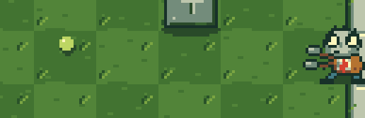

[Flag carrier death](flag_death.gif) · [Zombie damage flash](zombie_damage_flash.png) · [Plant damage flash](plant_red_flash.png)

## Hordes and tombstones

Follow the progress bar across the top. Each flag marks an incoming horde, and
turns yellow when its Flag Zombie enters the screen. Ordinary groups arrive
between flags. Once half a group has been defeated, the next can begin arriving;
you don't get a fresh preparation break between them. The final horde is larger
than the earlier ones.

Tombstones appear from 1-6. You can't plant on them, and peas hit the stone before
they can reach a zombie behind it. Six peas break one; cracks show its damage.
Bombs and mowers can destroy them too.

Each standing tombstone raises a zombie when a horde leader arrives. The zombie
climbs out of the dirt before walking or biting, and you can hit it during the
climb. Destroying the stone prevents later raises, but won't cancel one already
on its way out.

| Breaking a tombstone | A zombie emerging |
| --- | --- |
| 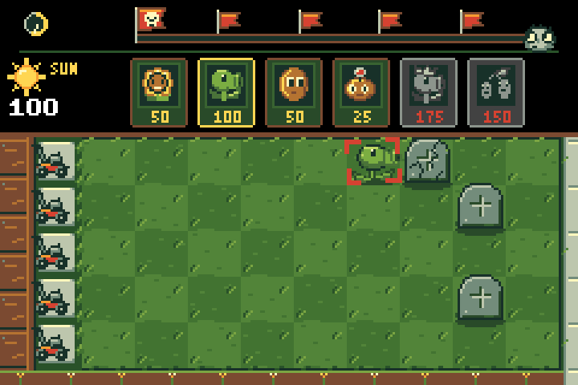 |  |

## Mowers, wins, and defeats

Each active lane has one mower beside the house. If a zombie gets that far, the
mower races along the lane and clears its path. It's gone for the rest of the
round, so rebuild that defense before another zombie breaks through.

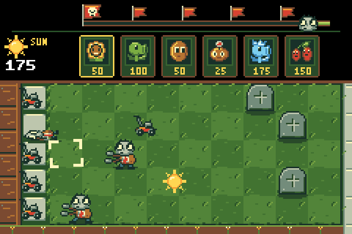

After the last zombie, any moving mower or active explosion finishes before the
reward arrives. A first clear with a new unlock earns a bouncing seed packet.
Repeat clears and rounds without a plant reward earn a trophy. The lawn and HUD
stay visible behind the reward and its wooden sign.

After the reveal, any button returns to levels. Clearing 1-10 also returns there,
so you can replay the campaign.

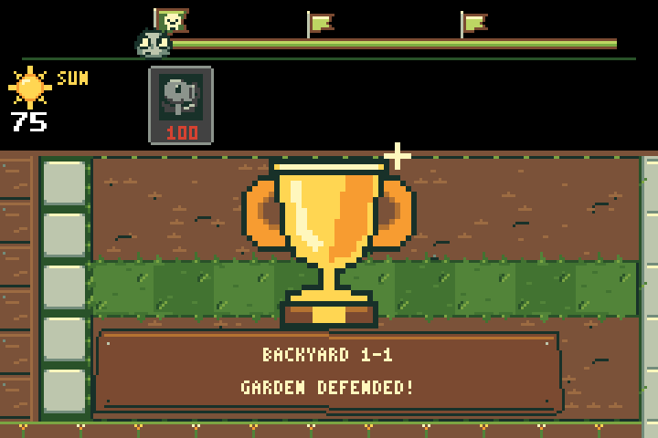

If a zombie reaches the house after the mower is gone, the music stops, followed
by a record scratch and the defeat scream. Wait for the sequence to finish, then
press A/START to retry through scouting or B to choose another level.

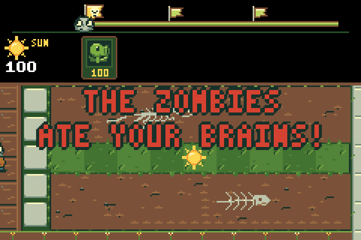

## Almanac and audio

Choose **Almanac** from the title screen. Plants and zombies appear in cells; open
one with A to read its description and stats. Portraits animate while you read.
Plant entries show sun cost, recharge, and health. Zombie entries combine body
health and protection into durability and show your saved kills of that type.
Kill counts belong to a save slot: continue that slot before opening the Almanac
to check its records.

L/R changes pages, D-pad moves within the current grid, and B goes back. On an
entry, Up/Down scrolls the description; the bar on the right shows your position.

| Plant grid | Zombie entry and saved kills |
| --- | --- |
| 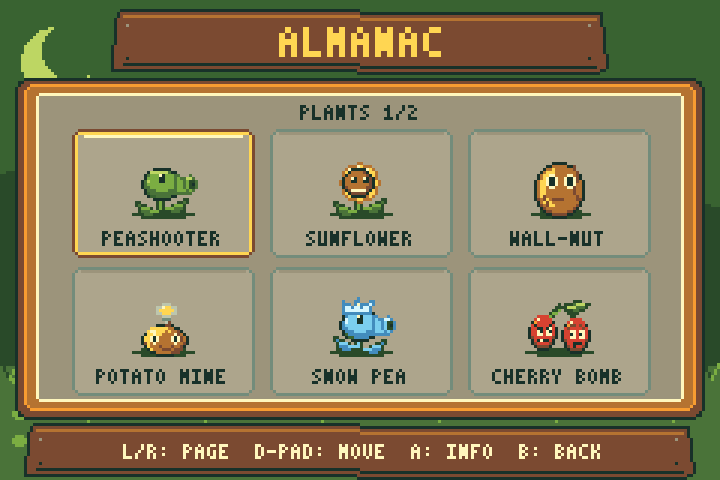 | 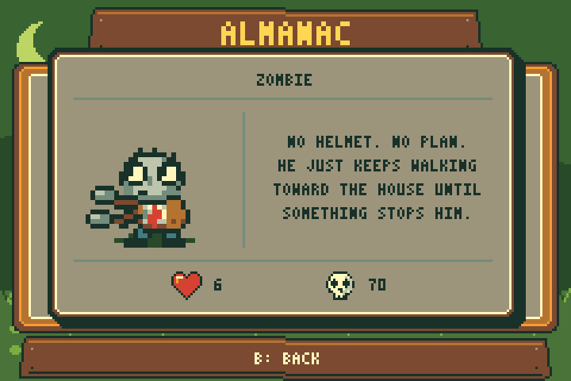 |

START pauses a round. The menu offers Resume, Restart, and Levels, plus separate
Master, Music, and Effects sliders. Use Up/Down to choose a slider and Left/Right
to adjust it. The settings last through restarts and menu visits, then reset when
you relaunch the ROM.

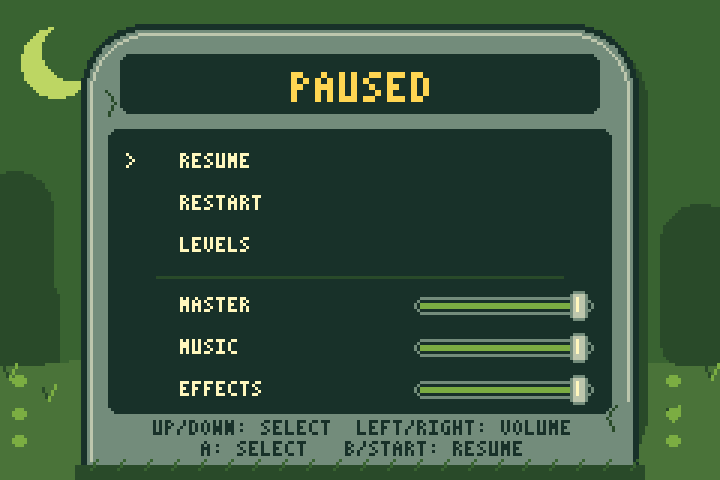

## Controls at a glance

| Screen | Controls |
| --- | --- |
| Lawn | D-pad: cursor · A: plant · L/R: seed · B: collect sun · Select + A: shovel · START: pause |
| Title | Up/Down: select · A/START: open |
| Save slots | Up/Down: slot · Left/Right: action · A: confirm · B: title |
| Delete confirmation | Left/Right: Cancel/Delete · A: confirm · B: cancel |
| Levels | D-pad: select · A/START: scout · B: title |
| Scouting | A/START: continue · B: levels |
| Seed selection | D-pad: select · A: add/remove · START: confirm six · B: scouting |
| Almanac grid | D-pad: select · L/R: page · A: details · B: title |
| Almanac details | Up/Down: scroll · B: grid |
| Pause | Up/Down: select · Left/Right: volume · A: action · B/START: resume |
| Reward | Any button: levels, after the reveal |
| Defeat | A/START: retry · B: levels, after the sequence |

Holding the D-pad repeats cursor movement. Holding L/R cycles seeds. Holding B
collects sun as it appears.

## More images

[All plant entries](almanac_plant_entries.png) · [All zombie entries](almanac_zombie_entries.png) ·
[Wall-nut damage](wallnut.png) · [Lawn edge and mower parking](lawn_edge.png) ·
[The final skull flag](final_flag.png) · [Full gameplay animation](gameplay.gif)

The following close-up studies are assembled from sprite sheets rather than
captured gameplay: [Football charge](football_charge_study.gif),
[Pole Vaulter poses](pole_vaulter_study.gif), [Screen Door biting](screen_door_bite_study.gif),
[falling equipment](falling_equipment_study.gif), and [zombie deaths](zombie_deaths_study.gif).

For build instructions, tests, audio credits, and screenshot capture tools, see the
[development guide](DEVELOPMENT.md).
