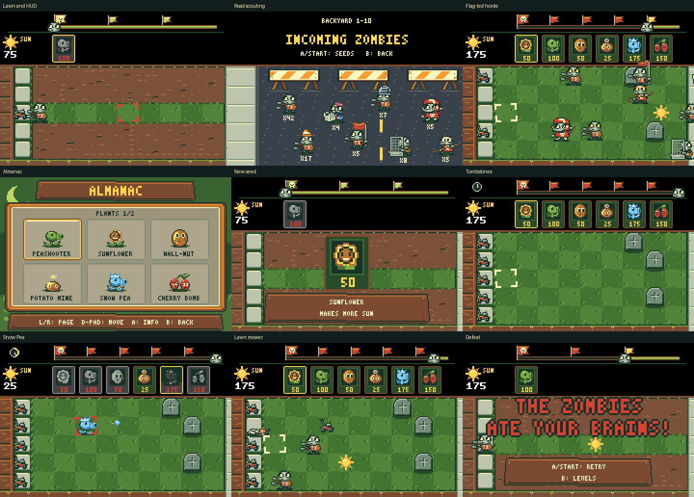

# Screenshots and animations

Current captures from the normal and debug ROMs in mGBA. Screenshots use integer
nearest-neighbor scaling. Comparison labels sit outside the game image. GIFs use
captured frames, sometimes holding the first or last frame for readability.



## Menus and campaign

| Feature | Captures |
| --- | --- |
| Title | [Screen](title.png), [animation](title.gif) |
| Pause and audio | [Default mixer](paused.png), [channel comparison](mixer.png), [master muted](mixer_master_muted.png), [music muted](mixer_music_muted.png), [effects muted](mixer_effects_muted.png) |
| Level progression | [Locks](levels_locked.png), [completion and next unlock](levels_progress.png), [progress after relaunch](levels_reloaded.png), [all levels unlocked in debug](levels_debug.png) |
| Scouting | [Backyard 1-1](preview_level_1.png), [Backyard 1-10](preview_level_10.png), [camera pan](scouting.gif) |
| New plant reward | [Bouncing packet](plant_reward_mid.png), [final wooden sign](plant_reward.png), [animation](plant_reward.gif) |
| Repeat-clear reward | [Trophy and wooden sign](trophy_reward.png) |
| Defeat | [Breach](loss_animation.png), [retry prompt](loss_prompt.png), [animation](defeat.gif) |

Reward screens leave the HUD visible and have no floating heading or button
prompt. Once the reveal finishes, any button opens level selection. Defeat has
separate controls: A / START retries and B opens levels, after the scream finishes.

## Lawn, combat, and feedback

| Feature | Captures |
| --- | --- |
| Opening lawns | [One lane](lawn_start.png) · [Three lanes](lawn_three_lanes.png) |
| Road entry | [Walking into view](road_entry.png), [entry animation](road_entry.gif) |
| Lawn defense | [Developed garden](gameplay.png), [gameplay animation](gameplay.gif), [starting lawn](lawn_start.png), [house-side edge](lawn_edge.png) |
| Seed selection | [Roster over the road](seed_selection.png) · [Custom six-packet bank](seed_selection_custom.png) |
| Seed count error | [Incomplete bank](seed_selection_error.png) |
| Seed tray animation | [Packets moving into the tray](seed_bank_flight.gif) |
| Chomper | [Bite animation](chomper_bite.gif) · [Chewing](chomper_chewing.png) |
| Repeater animation | [Two-shot burst](repeater_burst.gif) |
| New plants | [Repeater paired peas](repeater_pair.png) · [Squash leap](squash_leap.gif) |
| Seed packets | [Six selected icons and prices](seed_packets.png) |
| Placement feedback | [Comparison](placement.png), [check](placement_check.png), [occupied cross](placement_occupied.png), [cooldown hourglass](placement_cooldown.png), [unaffordable seed](placement_unaffordable.png) |
| Sun collection | [Sequence](sun_collection.png), [flight animation](sun_collection.gif), [before](sun_before.png), [collection starts](sun_start.png), [mid-flight](sun_mid.png), [arrived](sun_arrived.png) |
| Shovel | [Selected plant](shovel_selected.png), [after removal](shovel_removed.png) |
| Wave progress | [Three-flag track](wave_track_3.png), [five-flag track during a horde](wave_track_5.png), [final skull flag](final_flag.png) |
| Flag-led groups and armor | [Horde](armored_horde.png), [flag carrier dying](flag_death.png), [flag drop and backward fall](flag_death.gif) |
| Freezing | [Snow Pea and slowed zombie](snow_pea_gameplay.png) |
| Damage flashes | [Plant](plant_red_flash.png), [zombie](zombie_damage_flash.png) |
| Zombie damage and death | [Falling arm](zombie_arm_drop.png), [missing arm](zombie_missing_arm.png), [collapse](zombie_death.png), [close-up animation](zombie_damage_death.gif), [full scene](zombie_combat.gif) |
| Explosions | [Blast above plants in a lower lane](explosion_above_plants.png) |
| Mowers | [Moving mower](mower_active.png), [close-up](mower_closeup.png) |
| Wall-nut damage | [Comparison](wallnut.png), [healthy](wallnut_healthy.png), [damaged](wallnut_damaged.png), [nearly eaten](wallnut_worn.png) |
| Potato Mine | [Sequence](mine.png), [arming](mine_arming.png), [armed](mine_armed.png), [detonation](mine_burst.png), [spent cell](mine_spent.png) |
| Tombstones | [Later-level layout](tombstones_lawn.png), [cracked](tombstone_cracked.png), [destroyed](tombstone_destroyed.png), [crumbling stone](tombstone_crumble.png), [crumble animation](tombstone_crumble.gif), [zombie emerging](grave_emergence.png), [emergence animation](grave_emergence.gif) |

## Almanac

[Plant grid](almanac_plants.png) · [Zombie grid](almanac_zombies.png) ·
[Saved lifetime kills](almanac_lifetime_kills.png)

| Plants | Zombies |
| --- | --- |
| [Sunflower](almanac_plant_sunflower.png) | [Normal](almanac_zombie_normal.png) |
| [Peashooter](almanac_plant_peashooter.png) | [Conehead](almanac_zombie_conehead.png) |
| [Wall-nut](almanac_plant_wallnut.png) | [Newspaper](almanac_zombie_newspaper.png) |
| [Cherry Bomb](almanac_plant_cherry_bomb.png) | [Flag](almanac_zombie_flag.png) |
| [Potato Mine](almanac_plant_potato_mine.png) | [Buckethead](almanac_zombie_buckethead.png) |
| [Snow Pea](almanac_plant_snow_pea.png) | [Screen Door](almanac_zombie_screen_door.png) |
| [Squash](almanac_plant_squash.png) | [Football](almanac_zombie_football.png) |
| [Tall-nut](almanac_plant_tallnut.png) | [Pole Vaulter](almanac_zombie_pole_vaulter.png) |
| [Repeater](almanac_plant_repeater.png) | — |
| [Chomper](almanac_plant_chomper.png) | — |

[All plant entries](almanac_plant_entries.png) · [All zombie entries](almanac_zombie_entries.png)

## Sprite animation studies

These studies composite the current indexed assets on grass; they are
**not ROM screenshots**. They make the small poses easier to inspect. Gameplay
adds equipment trajectories, lane ordering, hit flashes, and actual combat timing.

- [Standard zombie collapse and fade](zombie_deaths_study.gif)
- [Newspaper zombie collapse and fade](newspaper_deaths_study.gif)
- [Flag zombie backward fall](flag_deaths_study.gif)
- [Football charging poses](football_charge_study.gif)
- [Football zombie collapse](football_deaths_study.gif)
- [Falling arms, cone, paper, bucket, screen door, flag and football equipment poses](falling_equipment_study.gif)

## Refreshing

From the project root, after installing the build dependencies, Pillow and libmgba:

```sh
sh tools/refresh_docs.sh
```

This rebuilds both ROMs, runs the sanitizer suite, runs normal/debug/loss
integration checks, captures the extra gallery scenarios, and publishes the images.
Everything runs sequentially because builds and captures share temporary files.
No player save files are read or overwritten; each emulator check uses fresh SRAM.

To run only the capture/publication stages after building:

```sh
cc -Wall -Wextra -Werror tools/rom_smoke.c \
  -I/usr/local/include -L/usr/local/lib -lmgba -o build/rom_smoke
build/rom_smoke plants_vs_zombies.gba
build/rom_smoke plants_vs_zombies_debug.gba debug
build/rom_smoke plants_vs_zombies.gba loss
build/rom_smoke plants_vs_zombies_debug.gba gallery
python3 tools/generate_previews.py
```

Adjust compiler paths for your libmgba installation. `gallery` runs on the debug
ROM and includes ordinary-button scenarios for placement, sun, shovel, audio,
mines, Wall-nuts, mowers and zombie death. It does not patch gameplay or save memory.

The publisher validates all required captures against their normal/debug ROM
before replacing any images. After successful publication, it removes obsolete
PNG/GIF files from this directory. [captures.json](captures.json) records the ROM
SHA-256 hashes, capture sources, animation timing and complete published file list.
The old three-level, runner-era and retired-menu images are no longer published.

[Build and play guide](../README.md) · [Development guide](DEVELOPMENT.md)

The early-level tutorial captures show planting, collecting sun, shoveling wilted plants, and planting Sunflower. `almanac_scrolled.png` shows the wrapped description and scroll thumb.

`wilted_tutorial.gif` shows the flashing gold cell and the wilted weeds sagging, recovering and blinking in the running ROM.
