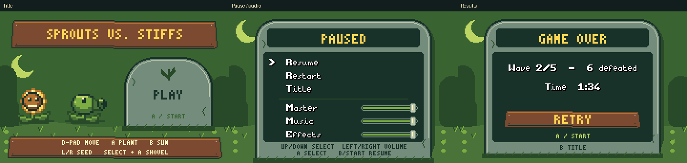

# Current screenshots and artwork

These previews document **Sprouts vs. Stiffs**. Recreate them from the current
ROM and generated assets using the verification commands in the
[project README](../README.md#verification-and-screenshots).

```sh
build/rom_smoke
python3 tools/generate_previews.py
```

The smoke check must run after rebuilding the ROM. It writes PPM captures to
`build/`; the preview script replaces the images here using integer nearest-neighbor
scaling. The historical graphics comparison has been retired so the gallery
shows only the current game.

## Captured from the ROM



| View | Capture |
| --- | --- |
| Title | [Title screen](title.png), [animated capture](title.gif) |
| Gameplay | [Lawn and HUD](gameplay.png) |
| House-side lawn border | [Porch, pavers, and grass edge](lawn_edge.png) |
| Pause | [Menu and default volumes](paused.png) |
| Results | [Game over and statistics](defeat.png) |
| Wave progress | [Track and flags](waves.png), [completed checkpoint](wave_checkpoint.png), [indicator close-up](wave_indicator.png), [final flag](final_flag.png) |
| Seed portraits | [Packet close-up](seed_packets.png) |
| Placement feedback | [Occupied cell](occupied.png), [cooldown](cooldown.png), [insufficient sun](unaffordable.png), [shovel](shovel.png) |
| Combat | [Chewing encounter](chewing.png), [cherry explosion](explosion.png) |
| Mixer | [Music muted](audio_music_muted.png), [master muted](audio_master_muted.png) |
| Sun collection | [Sequence](sun_collection.png), [before](sun_collection_before.png), [start](sun_collection_start.png), [mid-flight](sun_collection_mid.png), [arrived](sun_collection_arrived.png) |

The results screenshot is a loss captured by the smoke scenario. A complete
victory is verified separately by the host simulation tests; it is not pictured.

## Generated asset previews

These images use the current indexed sprite assets composited on grass. They
are artwork studies, not screenshots of a separate game mode. The GIFs show
sprite poses; gameplay also applies positioning and timing in the renderer.

| Artwork | Preview |
| --- | --- |
| Plants and cone zombie | [Idle GIF](plant_idle.gif), [first pose](plant_idle.png) |
| Zombie walking and eating poses | [Pose strip](zombies.png), [eating GIF](zombie_eating.gif) |
| Cone and face | [Close-up](cone.png) |
| Sun token | [Sun texture](sun.png) |
| Lawn mower | [Handle, engine, deck, and wheels](mower.png) |
| Shovel | [Icon](shovel_icon.png) |
